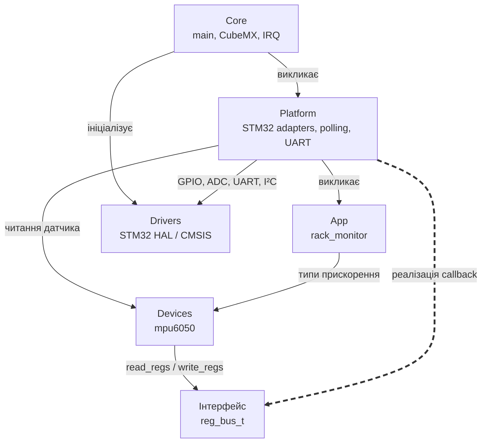
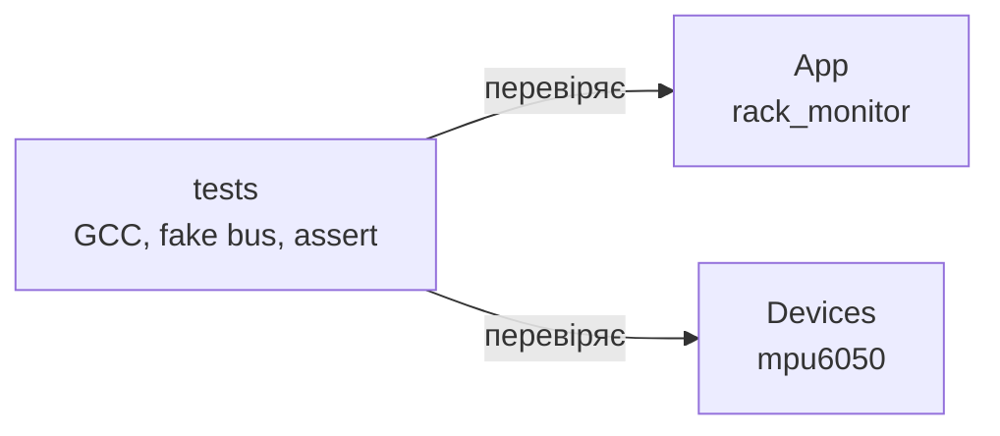

# Архітектура проєкту — Server Rack Health Monitor

Прошивка **Server Rack Health Monitor** побудована на STM32C031C6 із використанням STM32 HAL. Код, що залежить від конкретної плати, відокремлено від драйвера MPU-6050 та логіки моніторингу. Це дозволяє перевіряти обробку даних і правила тривог звичайним компілятором GCC, без запуску Wokwi або фізичного мікроконтролера.

## 1. Структура та призначення модулів

```text
firmware/
├── Core/                 Згенеровані CubeMX main, ініціалізація, обробники переривань
├── Drivers/              Локальні копії бібліотек ST HAL і CMSIS
├── Platform/             Прив'язка прошивки до STM32, периферія та основний цикл
│   ├── platform.h
│   └── platform.c
├── Devices/              Драйвер MPU-6050 та абстракція регістрової шини
│   ├── bus_interface.h
│   ├── mpu6050.h
│   └── mpu6050.c
├── App/                  Режими роботи, обробка даних і правила тривог
│   ├── rack_monitor.h
│   └── rack_monitor.c
├── firmware.ioc          Вихідна конфігурація STM32CubeMX
├── Makefile              Згенеровані правила збірки
└── GNUmakefile           Власні доповнення до правил збірки

tests/
├── test_main.c           Хостові перевірки з fake-шиною та assert
└── Makefile              Збірка тестів, перевірка залежностей, gcov
```

**Core** містить `main.c`, налаштування тактування, `GPIO`, `I2C1`, `USART2`, `ADC1` та системні обробники. Після ініціалізації периферії `main()` передає її хендли в `Platform_Init(&huart2, &hi2c1, &hadc1)`, а в нескінченному циклі викликає `Platform_Step()`. Реалізація `_write()` у захищеній секції `USER CODE` пересилає `printf()` через `HAL_UART_Transmit()`.

**Platform** знає конкретні хендли, регістри STM32 та призначення GPIO. Тут реалізовано читання ADC із маркером на PA4, опитування кнопки на PA1, керування LED на PA5, обмін I²C, приймання UART-команд, самоперевірку й періодичне опитування пристроїв. Цей модуль також поєднує результати драйвера з прикладною логікою та формує повідомлення UART. Таким чином, координація виконання зосереджена у `Platform`, а не у згенерованому `main.c`.

**Devices** містить власний драйвер MPU-6050: читання `WHO_AM_I`, чотири записи конфігурації, отримання шести байтів прискорення та їх перетворення в `mg`. Він не включає HAL-заголовків і не знає, який контролер фізично виконує операції над шиною.

**App** реалізує незалежні від HAL правила: `ACTIVE`/`MAINTENANCE`, перетворення відліків ADC на температуру, виявлення удару за модулем прискорення відносно 1g, debounce дверцят 50 мс, обмеження повторних тривог 5 с та стан світлодіода. Структура `rack_monitor_t` зберігає поточні значення, стан режиму й лічильники подій.

## 2. Component diagram і напрямки залежностей


**Компоненти прошивки та їхні залежності:**



**Перевірка модулів на хості:**



На основній діаграмі суцільні стрілки відображають виклики та використання компонентів, а пунктирна — надання реалізації callback-функцій для `reg_bus_t`. Окрема схема показує хостове тестування модулів `App` і `Devices` без використання STM32 HAL. Залежність `App → Devices` тут **обмежена типами даних**: `rack_monitor.h` включає `mpu6050.h`, щоб працювати зі структурою `mpu6050_accel_mg_t`. Це не дає прикладній логіці доступу до HAL або периферійних регістрів.

Ключове правило проєкту — **`App/` і `Devices/` не включають `main.h`, `platform.h` чи STM32 HAL-заголовки**. Саме тому їх можна компілювати й тестувати на хості. На відміну від них, `Platform/` та згенерований `Core/` мають право залежати від HAL і конфігурації плати.

## 3. Незалежний доступ драйвера до I²C

У [`bus_interface.h`](../firmware/Devices/bus_interface.h) оголошено `reg_bus_t`: покажчик контексту `void *ctx` і дві функції `read_regs` та `write_regs`. Операції повертають `BUS_OK`, `BUS_ERR_NACK`, `BUS_ERR_TIMEOUT` або `BUS_ERR_PARAM`.

Під час `Platform_Init()` адаптери `platform_i2c_read_regs()` і `platform_i2c_write_regs()` передаються драйверу через цю структуру. Контекстом слугує `I2C_HandleTypeDef *`. Усередині `Platform` I²C-транзакції виконуються через регістри периферії STM32 з очікуванням прапорців, перевіркою NACK і обмеженням циклів очікування. Драйвер MPU-6050 викликає лише функції інтерфейсу, а не `HAL_I2C_Mem_Read()` чи регістри STM32.

У [`tests/test_main.c`](../tests/test_main.c) замість справжньої шини використовуються `fake_read()` і `fake_write()`. Вони повертають підготовлені байти, дозволяють імітувати NACK/timeout та перевіряють порядок чотирьох конфігураційних записів. Отже, заміна реалізації шини не вимагає змін у `mpu6050.c`.

## 4. Основний цикл та обробка подій

`Platform_Init()` запускає самоперевірку MPU-6050, ADC та кінцевого вимикача; підсумок виводиться через UART. Після цього `Platform_Step()` послідовно обробляє введені команди, опитує датчики за часом `HAL_GetTick()`, оновлює `rack_monitor_t`, керує світлодіодом та періодично друкує телеметрію. Окремої RTOS або потоків у проєкті немає.

| Операція | Реалізація в коді |
|---|---|
| Опитування MPU-6050 | `IMU_POLL_PERIOD_MS = 20U` (номінально 50 Гц) |
| Опитування ADC | `ADC_POLL_PERIOD_MS = 20U` (номінально 50 Гц) |
| Телеметрія UART | `TELEMETRY_PERIOD_MS = 1000U` |
| Кінцевий вимикач | GPIO PA1; стан обробляється під час оновлення даних монітора; debounce 50 мс |
| Індикація | GPIO PA5; стан визначає `rack_monitor_get_led_state()` |
| Службовий маркер ADC | GPIO PA4 встановлюється перед операцією ADC і скидається після неї |

Номінальні періоди — програмні пороги, а не гарантія жорсткого реального часу: операції I²C, виклики HAL та UART-вивід виконуються в тому самому циклі. Їхні фактичні часові характеристики розглядаються окремо у [`captures/analysis.md`](captures/analysis.md).

Команди `status`, `maint`, `active`, `clear`, `probe` та `sim_nack` обробляє `Platform`. Зокрема, `probe` ініціює контрольне читання ID та прискорення, а `sim_nack` викликає звернення до відсутньої I²C-адреси `0x69`. Розподіл відповідальності такий: **`Platform` вирішує, коли й звідки отримати дані, `Devices` — як прочитати MPU-6050, `App` — як інтерпретувати дані та визначити тривогу.**

## 5. Знання про плату та повторна генерація CubeMX

Відповідність пінів, хендлів і периферії зафіксована у [`firmware.ioc`](../firmware/firmware.ioc), а схема підключення та обґрунтування — у [`pinout.md`](pinout.md). Згенеровані функції `MX_GPIO_Init()`, `MX_I2C1_Init()`, `MX_USART2_UART_Init()` та `MX_ADC1_Init()` залишаються в `Core/Src/main.c`; робочі операції над пристроями виконуються через `Platform`.

У `.ioc` зазначено, зокрема, PA9/PA10 для I²C1, PA2/PA3 для USART2, PA0 для ADC1, PA1 для кнопки, PA4 для маркера та PA5 для LED. Усі використані периферійні хендли передаються в `Platform_Init()` явно. Знання про регістри та сигнали GPIO, потрібні під час роботи, не виноситься в `App` або драйвер датчика.

Повторна генерація з `.ioc` може перезаписати згенеровані ділянки `main.c` і `firmware/Makefile`. Тому власні виклики `Platform_Init()` і `Platform_Step()`, як і `_write()`, розміщено в секціях `USER CODE BEGIN/END`. Налаштування PA4 також внесене в `.ioc`, а не існує лише як ручна зміна `MX_GPIO_Init()`.

Для правил збірки додано окремий [`firmware/GNUmakefile`](../firmware/GNUmakefile). GNU Make читає його раніше за `Makefile`; файл підключає згенерований `Makefile`, а потім доповнює списки власними `Platform/platform.c`, `Devices/mpu6050.c`, `App/rack_monitor.c` (без повторного додавання, якщо вони вже наявні), include-шляхами та залежностями об'єктних файлів. Це зменшує ризик втрати підключення власних модулів після регенерації. Після повторної генерації все одно слід перевірити diff `.ioc`/`Core` і повторити збірку: `USER CODE` не захищає довільні зміни поза відповідними секціями.

## 6. HAL, CMSIS та сторонні залежності

Файли ST розміщені безпосередньо в `firmware/Drivers/`, а не завантажуються при кожній збірці з мережі. У поточному дереві репозиторію зазначені такі версії:

| Компонент | Версія та підтвердження |
|---|---|
| STM32Cube Firmware C0 | `V1.4.1` — `ProjectManager.FirmwarePackage` у `firmware.ioc` |
| STM32C0 HAL | `1.4.1` — макроси `__STM32C0xx_HAL_VERSION_*` у `Drivers/STM32C0xx_HAL_Driver/Src/stm32c0xx_hal.c` |
| CMSIS Device STM32C0 | `1.4.1` — `__STM32C0_CMSIS_VERSION_*` у `Drivers/CMSIS/Device/ST/STM32C0xx/Include/stm32c0xx.h` |
| CMSIS-Core(M) | `5.6` — значення макросів `__CM_CMSIS_VERSION_MAIN` / `SUB` у `Drivers/CMSIS/Include/cmsis_version.h` |

У [`stm32c0xx_hal_conf.h`](../firmware/Core/Inc/stm32c0xx_hal_conf.h) увімкнено `ADC`, `I2C`, `UART` та `GPIO` — для відповідних периферійних функцій стенда. `RCC`, `FLASH`, `PWR`, `CORTEX` і базовий `HAL` забезпечують системну ініціалізацію та роботу MCU. Також у згенерованій конфігурації ввімкнено `DMA` і `EXTI`, проте прикладний код не використовує DMA-передач, а дверцята читає опитуванням GPIO, не через EXTI. Модулі `SPI`, `TIM` і `RTC` не ввімкнені.

Власний драйвер MPU-6050 не використовує сторонніх Arduino-бібліотек або middleware. Його адреси, регістри й масштаб ±2g задані безпосередньо у `mpu6050.h`; джерело опису регістрів наведено в [`pinout.md`](pinout.md). Вендорський код зафіксований у Git разом із проєктом; це зберігає саме використані вихідні файли бібліотек.

## 7. Збірка, правила залежностей і CI

У кореневому [`Makefile`](../Makefile) команда `make build` збирає Docker-образ із [`docker/Dockerfile`](../docker/Dockerfile), запускає контейнер і виконує `make -C firmware all`. Базовий образ — `ubuntu:22.04`; ARM GCC, binutils, newlib та інші інструменти встановлюються пакетним менеджером. Локальна збірка створює `firmware.elf`, `firmware.hex`, `firmware.bin` у `firmware/build/`.

Згенерований `firmware/Makefile` використовує `-Wall`, а для `main.o`, `platform.o`, `mpu6050.o`, `rack_monitor.o` додатково встановлюється `-Wextra`. Власні модулі також підключаються через `GNUmakefile`. Команда `make -C tests all` окремо запускає `check-deps`, компілює тести звичайним GCC, виконує `assert`-перевірки та формує звіт `gcov` для `rack_monitor.c` і `mpu6050.c`.

Архітектурне правило перевіряється ціллю `check-deps` у `tests/Makefile`. Перед запуском тестів виконується пошук заборонених включень заголовків STM32 HAL, `platform.h` та `main.h` у каталогах `App/` і `Devices/`. У разі виявлення порушення перевірка завершується помилкою. Таким чином, контроль напрямків залежностей є частиною автоматизованого тестування проєкту.

[GitHub Actions](../.github/workflows/ci.yml) запускає завдання `build-and-test` під час push у `main` та `lab-2`, а також для pull request у `main`. Послідовно виконуються встановлення інструментів, `make -C firmware all` і `make -C tests all` — з перевіркою залежностей та покриттям. У GitHub Actions збірка та тести виконуються безпосередньо на середовищі `ubuntu-latest`. Для локальної перевірки збірки в контейнері передбачена окрема команда `make build`.

## 8. Межі відповідальності документів

Цей документ фіксує фактичну структуру, зв'язки модулів та правила збірки. Розкладку пінів, електричні параметри й вибір периферії описано у [`pinout.md`](pinout.md); декодовані захоплення й вимірювання I²C, UART, ADC та GPIO — у [`captures/analysis.md`](captures/analysis.md). Детальні результати тестування й функціональних сценаріїв належать до загального звіту ЛР2, щоб не дублювати ті самі докази в кількох місцях.
