# Аналіз записів логічного аналізатора — Server Rack Health Monitor

У цьому документі розглянуто результати захоплення сигналів системи **Server Rack Health Monitor** у симуляторі Wokwi. На основі записів `wokwi.vcd` та `fault-nack.vcd` перевірено обмін із MPU-6050, декодування інтерфейсів, часові параметри та реакцію системи на контрольовану помилку I²C. Розрахункові параметри периферії наведено окремо в [pinout.md](../pinout.md).


## 1. Стенд і параметри запису

Використано STM32 **NUCLEO-C031C6** із трьома пристроями: MPU-6050 на I²C, потенціометром як аналоговою моделлю LM35 та кінцевим вимикачем дверцят на GPIO. UART передає результати самоперевірки, телеметрію та тривоги. Усі пристрої працюють в одній прошивці.

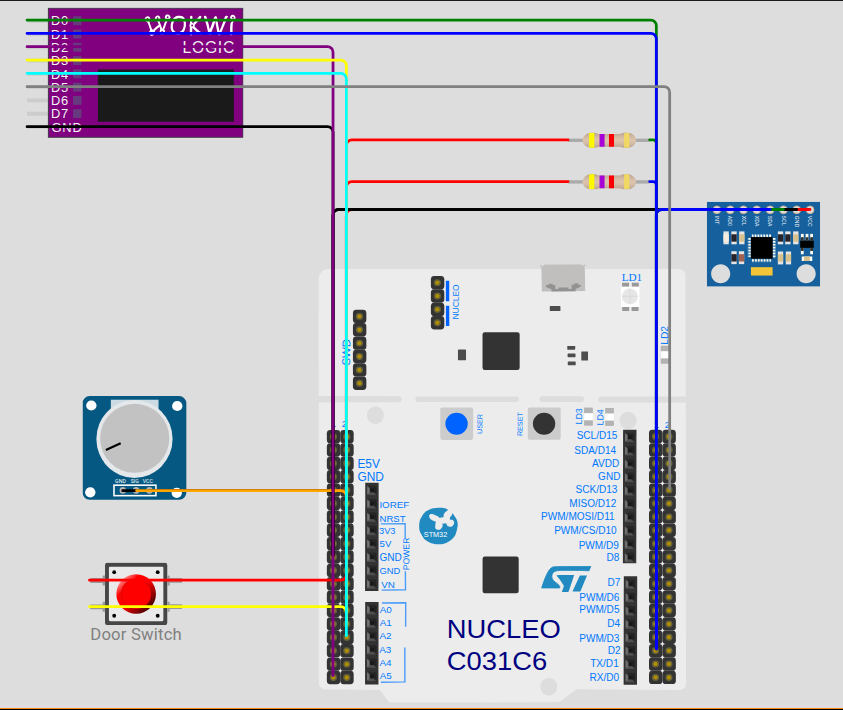

*Рис. 1 — схема симуляції з підключеним логічним аналізатором.*

Логічний аналізатор `logic1` підключено до шести сигналів:

| Канал | Пін STM32 | Сигнал | Призначення |
|---|---|---|---|
| D0 | PA9 | `I2C1_SCL` | Тактування MPU-6050 |
| D1 | PA10 | `I2C1_SDA` | Дані MPU-6050 |
| D2 | PA2 | `USART2_TX` | Повідомлення прошивки |
| D3 | PA1 | `DOOR_SW` | Стан кінцевого вимикача |
| D4 | PA4 | `ADC_CONV_MARK` | Маркер процедури читання ADC |
| D5 | PA3 | `USART2_RX` | Приймання команд із термінала |

Записи зберігаються у форматі VCD, дозволеному для **форми B**. У `diagram.json` аналізатор має `bufferSize = 10000000`. Окремий апаратний тригер не налаштовано: захоплення починається разом із симуляцією, а потрібні ділянки виділяються після зупинки. Для фізичного аналізатора як тригер I²C можна використовувати умову START (спад SDA при високому SCL), а для перевірки дверцят — фронт PA1.

| Запис | Вміст | Тривалість | SHA-256 |
|---|---|---:|---|
| [`wokwi.vcd`](wokwi.vcd) | Нормальний запуск, I²C, UART, ADC, GPIO та робочі події | 34,116 с | `ff9a6fc9f34fc29822b74092d2e21d3f325090e9f389495db8e63cc6c2b247c8` |
| [`fault-nack.vcd`](fault-nack.vcd) | Окремий запуск із командою `sim_nack` | 6,150 с | `8d0fce72b11752e57824bd1ae13f36356058d72e16319b7823d0f01728fa0449` |

У заголовках обох VCD задано `$timescale 1ns`. Це **одиниця часових позначок**, а не твердження про безперервну апаратну дискретизацію на частоті 1 ГГц: VCD зберігає моменти змін рівня. Для перегляду в PulseView використано **Downsampling factor = 100**, тобто ефективну сітку імпорту **10 МГц (крок 0,1 мкс)**. Це дозволило відкрити довгий запис без перевантаження оперативної пам'яті та зберегти достатню деталізацію для I²C 100 кГц і UART 115200 бод. Для чисел із більшою точністю використано часові позначки оригінального VCD; підписи курсорів PulseView місцями округлені.

## 2. I²C: ідентифікація та ініціалізація MPU-6050

На шині `I2C1` розташований один пристрій — MPU-6050. Його вивід `AD0` підключено до землі, тому 7-бітна адреса дорівнює **`0x68`**. Шина працює в Standard-mode (розрахункова частота SCL — **100 кГц**); лінії SDA та SCL підтягнуті до 3,3 В зовнішніми резисторами 4,7 кОм.

### Ідентифікаційний регістр WHO_AM_I

Під час запуску драйвер звертається до регістра `WHO_AM_I` за адресою `0x75`. У PulseView декодовано таку послідовність:

```text
START → 0x68 W → ACK → 0x75 → ACK → STOP
START → 0x68 R → ACK → 0x68 → NACK → STOP
```

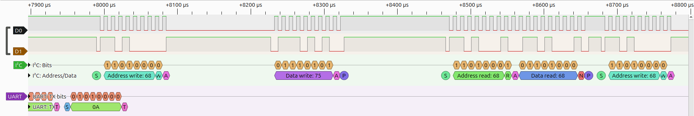

*Рис. 2 — звернення до регістра `WHO_AM_I` і повернення значення `0x68`.*

Перед читанням контролер окремою транзакцією передає адресу регістра, потім формує новий START на читання. Це **STOP + новий START**, а не repeated START без проміжного STOP — саме така реалізація застосована в `platform_i2c_read_regs()` у [platform.c](../../firmware/Platform/platform.c). Останній NACK після байта `0x68` формує **контролер**, повідомляючи про кінець одно-байтового читання. Він не означає відмову датчика.

Отримане значення збігається з очікуваним для MPU-6050 згідно з *MPU-6000/MPU-6050 Register Map and Descriptions*, Rev. 4.2 (регістр `WHO_AM_I`, `0x75`). Самоперевірка також повідомляє `who_am_i=0x68`, `status=OK`.

### Послідовність ініціалізації

Після успішного читання ідентифікатора драйвер надсилає чотири записи, які відповідають [mpu6050.c](../../firmware/Devices/mpu6050.c):

| Регістр | Записане значення | Призначення |
|---|---|---|
| `0x6B` — `PWR_MGMT_1` | `0x00` | Вихід із режиму сну |
| `0x1A` — `CONFIG` | `0x03` | Конфігурація цифрового фільтра |
| `0x19` — `SMPLRT_DIV` | `0x09` | Дільник частоти вибірки |
| `0x1C` — `ACCEL_CONFIG` | `0x00` | Діапазон акселерометра ±2g |

На кожному із записів видно адресу `0x68` у режимі W, байт регістра, байт даних і підтвердження ACK.

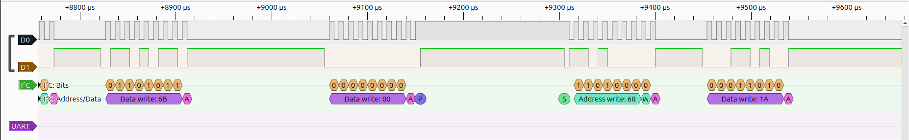

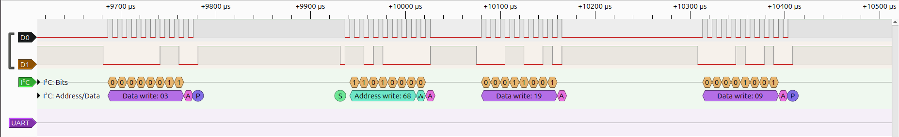

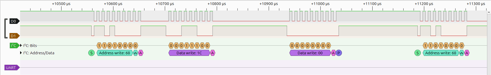

*Рис. 3–5 — послідовні фрагменти запису конфігураційних регістрів MPU-6050.*

### Ручне декодування байтів

Для перевірки результатів автоматичного декодера окремо розглянуто форму SCL/SDA біля **+7990 мкс**. Умова START виникає, коли **SDA переходить з HIGH у LOW, поки SCL залишається HIGH**. Далі контролер передає біти по старшинству; значення SDA зчитується під час високого рівня SCL.

Перші вісім тактів дають `1 1 0 1 0 0 0 0`, тобто `11010000₂ = 0xD0`. Старші сім бітів — `1101000₂ = 0x68` (адреса), молодший біт — `0` (запис). На дев'ятому такті SDA притиснута до LOW: це **ACK** від MPU-6050. Наступний байт, `01110101₂ = 0x75`, вибирає регістр `WHO_AM_I` та теж підтверджується ACK.

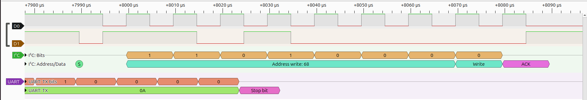

*Рис. 6 — адресний байт `0xD0` та дев'ятий такт ACK на реальних переходах D0/D1.*

У фазі читання адресний байт має вигляд `11010001₂ = 0xD1` (`0x68`, R=1), а значення відповіді — `01101000₂ = 0x68`. Таким чином, принаймні два послідовні байти перевірено і за бітами, і за значеннями у декодері.

## 3. I²C: багатобайтове читання прискорення

Після ініціалізації прошивка читає шість байтів, починаючи з `ACCEL_XOUT_H` (`0x3B`). Послідовність із захоплення:

```text
START → 0x68 W → ACK → 0x3B → ACK → STOP
START → 0x68 R → ACK
00 → ACK → 00 → ACK → 00 → ACK → 00 → ACK → 40 → ACK → 00 → NACK → STOP
```

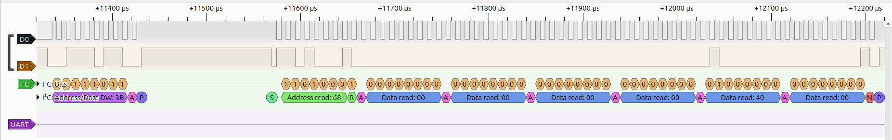

*Рис. 7 — декодовані дані MPU-6050, регістри від `0x3B` до `0x40`.*

За картою регістрів MPU-6050 ці пари байтів містять знакові 16-бітні значення X, Y і Z у форматі старший байт → молодший байт. Для діапазону ±2g чутливість дорівнює **16384 LSB/g**. Відповідно:

```text
raw = 00 00 | 00 00 | 40 00
X = 0x0000 =     0 LSB →    0 mg
Y = 0x0000 =     0 LSB →    0 mg
Z = 0x4000 = 16384 LSB → 1000 mg
```

Модуль прискорення в нерухомому стані: `√(0² + 0² + 1000²) = 1000 mg = 1,000 g`; відхилення від очікуваного **1g — 0%** для зафіксованого симуляційного положення. Це узгоджується із самоперевіркою та телеметрією UART (`ax=0 ay=0 az=1000 mg`). Ті самі шість байтів використано як `logic_analyzer_vector` у [tests/test_main.c](../../tests/test_main.c), де драйвер повинен повернути `0, 0, 1000 mg`. Отже, тестовий вектор має безпосереднє походження з захоплення шини, а не є довільним прикладом.

## 4. Вимірювання часових параметрів

Наведені значення виміряно на записах актуальної прошивки. Вони зіставляються з розрахунками `I2C_TIMINGR`, `USART_BRR` та ADC у [pinout.md](../pinout.md#4-параметри-шин-та-розрахунок-таймінгів-із-дерева-тактування). Там, де результат залежить від програмних затримок, не слід прирівнювати його до суто апаратного періоду.

| Параметр | Розрахунок / налаштування | Виміряно | Пояснення |
|---|---:|---:|---|
| Частота SCL усередині байта | 100 кГц | **100,0 кГц** (`T=10,0 мкс`) | Збігається з розрахунком I²C Standard-mode |
| Повна операція читання `WHO_AM_I` | ≈360 мкс на 36 бітових тактів без програмних пауз | **671,3 мкс** | Включає дві транзакції та паузи програмного адаптера |
| Пауза між `STOP` запису `0x75` та наступним `START` читання | Програмна затримка 120 мкс + накладні витрати | **138,6 мкс** | Додатково приблизно 18,6 мкс програмних витрат |
| Завершення ADC-маркера → наступний I²C START | Фіксований апаратний норматив не заданий | **19,275 мкс** | Час проходження ділянки програмного циклу |
| Тривалість одного біта UART | ≈8,687 мкс | **8,700 мкс** | Відповідає 115200 бод з невеликим відхиленням |
| Період запусків ADC | 20,000 мс | **20,0692 мс** | Відхилення приблизно +0,346% |
| Ширина маркера ADC | Апаратне перетворення ≈0,583 мкс | **60,9 мкс** | Маркер охоплює виклики HAL, а не лише перетворення |

**Примітка до розрахункових значень.** Теоретичні параметри частоти SCL, швидкості UART та часу апаратного перетворення ADC наведені у [pinout.md](../pinout.md), розділ 4. Оцінку тривалості читання `WHO_AM_I` без програмних затримок отримано за кількістю переданих бітів і розрахунковим періодом SCL. Програмна затримка 120 мкс між операціями I²C та періоди опитування датчиків визначені у [platform.c](../../firmware/Platform/platform.c). Для величин, що не мають фіксованого розрахункового нормативу, наведено результати безпосередніх вимірювань із VCD.


**Частота SCL.** На двох сусідніх наростаючих фронтах D0 видно `Δt = 10 мкс`; `f = 1 / 10 мкс = 100 кГц`. Таким чином, реальна цифрова модель шини відповідає розрахованим 100 кГц із п. 4.1.

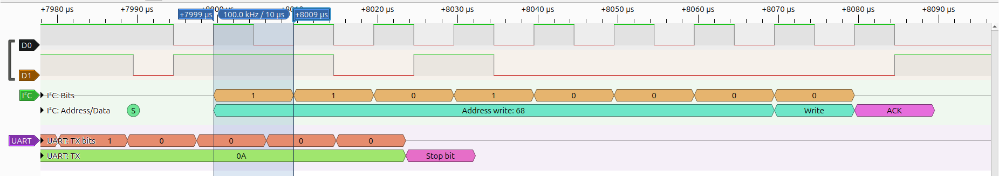

*Рис. 8 — період тактування SCL, показаний курсорами PulseView.*

**Тривалість операції.** Від першого START встановлення регістра `0x75` до фінального STOP після прочитаного ID минуло **671,3 мкс**. На шині передаються чотири байти разом із бітами ACK/NACK (36 тактів, номінально близько 360 мкс). Решта часу припадає насамперед на паузи й виконання операцій у `platform.c`. Зокрема, `i2c_raw_write()` використовує `platform_delay_us(120U)` під час передачі та після завершення запису. Це пояснює, чому ціла операція довша за суму активних тактів SCL.

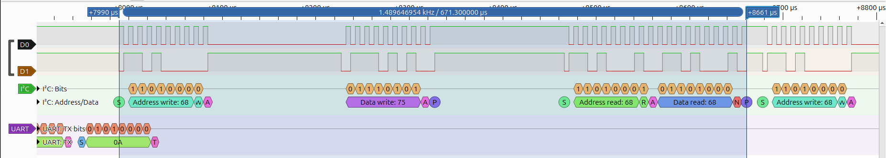

*Рис. 9 — вимірювання повної операції читання ідентифікатора: 671,3 мкс.*

**Інтервал між транзакціями.** Після `STOP` запису адреси регістра (`+8327,275 мкс`) наступний `START` виникає на `+8465,800 мкс`. Різниця за VCD — **138,525 мкс**, або **138,6 мкс** після округлення за курсорами. Це саме міжтранзакційна пауза `STOP → START`, а не період опитування датчика (у прошивці опитування MPU налаштоване на 20 мс).

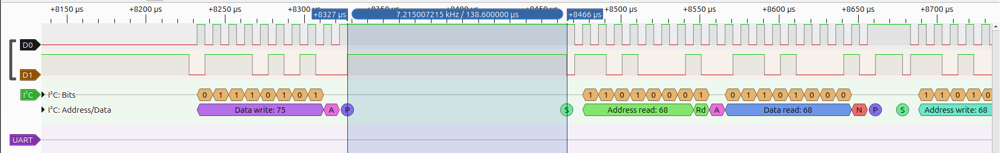

*Рис. 10 — час між записом покажчика регістра й початком читання.*

**Затримка реакції на шині.** Для прив'язки програмної події до цифрового інтерфейсу використано службовий маркер D4. Його спадний фронт, що означає **завершення позначеної ADC-процедури**, зафіксовано на `+81551,700 мкс`, а наступний START на I²C — на `+81570,975 мкс`. Затримка становить **19,275 мкс**. Це конкретний приклад інтервалу «подія в прошивці → дія на шині», але **не** час реакції на удар чи натискання кнопки; їхня логіка інша.

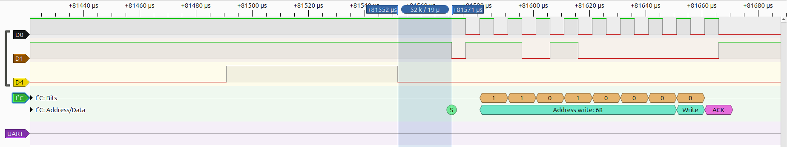

*Рис. 11 — програмно зумовлена затримка між завершенням ADC-операції та початком I²C.*

## 5. UART: передавання діагностичних повідомлень

`USART2` працює через PA2/PA3 у режимі **115200 бод, 8N1**: 8 інформаційних бітів, без парності, один стоповий біт. Декодер PulseView на D2 показує текст `[SELF-TEST]` та інші повідомлення, що збігаються з виводом термінала Wokwi.

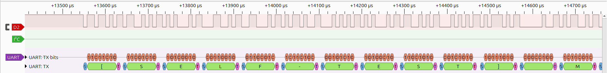

*Рис. 12 — цифровий сигнал UART TX і декодований початок `[SELF-TEST]`.*

Текстовий фрагмент самоперевірки з актуального запуску:

```text
[SELF-TEST] MPU6050 addr=0x68 who_am_i=0x68 ax=0 ay=0 az=1000 mg status=OK
[SELF-TEST] LM35_ADC ch=IN0 raw=312 temp=25.1C status=OK
[SELF-TEST] DOOR_SW pin=PA1 level=0 state=CLOSED status=OK
System Init OK | Mode=ACTIVE
```

На рівні окремого кадру UART перехід D2 від стартового LOW до першого HIGH займає **8,700 мкс**; це один біт початку символу `[` (`0x5B`, ASCII). Еквівалентна швидкість за таким одиничним вимірюванням — приблизно **114943 бод**. Розрахунок із `USART_BRR = 417` у `pinout.md` дає **115108 бод** та **8,687 мкс/біт**. Розбіжність виміряного часу біта з розрахунковим становить близько **0,15%**; вона мала й узгоджується з параметрами 115200 8N1.

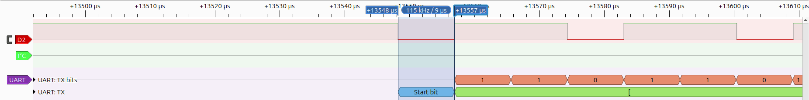

*Рис. 13 — 8,700 мкс між межами стартового біта UART (PulseView округлює курсори до 9 мкс).* 

## 6. ADC і GPIO: часові маркери та події

Для ADC не існує цифрової шини з адресами й байтами, тому момент опитування каналу `ADC1_IN0` фіксується службовим виходом **PA4/D4**. `platform_read_adc_marked()` піднімає D4 перед `HAL_ADC_Start()` та опускає після `HAL_ADC_Stop()`. Цифровий маркер доводить факт виконання процедури, але **не містить самого 12-бітного значення ADC**; значення читається в прошивці та виводиться через UART.

Період між наростаючими фронтами двох сусідніх маркерів дорівнює **20,0692 мс** (близько **49,83 Гц**). Це узгоджується з установленим у `platform.c` періодом `ADC_POLL_PERIOD_MS = 20U`; відхилення від 20 мс — приблизно **0,35%**.

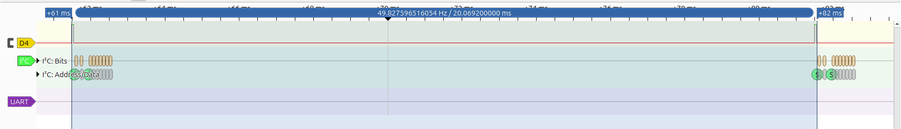

*Рис. 14 — два послідовні імпульси службового маркера ADC.*

Ширина одного імпульсу D4 становить **60,9 мкс**. У `pinout.md` розраховано ≈**0,583 мкс** для самого 12-бітного перетворення ADC при 24 МГц та обраному часі вибірки. Значення не зобов'язані збігатися: виміряний імпульс охоплює також програмні виклики HAL, опитування завершення перетворення й зупинку ADC.

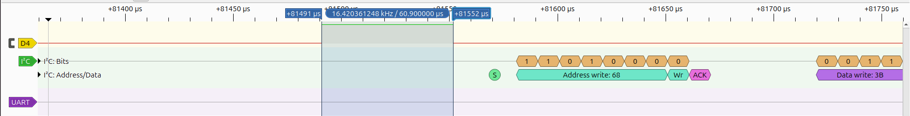

*Рис. 15 — імпульс D4 тривалістю 60,9 мкс.*

У нормальному стартовому стані потенціометр `temp1` дає **`raw=312`**. Обчислення, реалізоване у [rack_monitor.c](../../firmware/App/rack_monitor.c), переводить його в **25,1°C**; в UART видно те саме значення. Потенціометр є **емулятором аналогового виходу LM35**, а не фізичним LM35. Тому зміна показань — перевірка ланцюга «аналоговий рівень → ADC → обробка → UART», а не підтвердження метрологічної точності реального термодатчика.

Кінцевий вимикач використовує PA1/D3 з внутрішнім Pull-Down. У записі перед переходом входу в стабільний HIGH видно кілька швидких коливань рівня (брязкіт контакту). Після стабілізації сигналу до початку UART-повідомлення про відкриття дверцят за курсорами минуло **71,8627 мс**. У прошивці встановлено `RACK_DEBOUNCE_MS = 50U`; додатковий час включає опитування й передавання до UART. Отже, **71,86 мс — це повна виміряна реакція від вибраного стабільного фронту, а не власне величина debounce**.

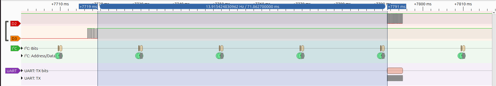

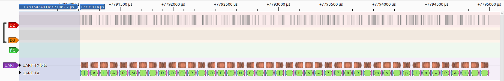

*Рис. 16–17 — стабілізація PA1, курсори до початку UART та декодоване `[ALARM] DOOR OPENED`.*

## 7. Штучно створена аномалія: NACK

Для перевірки обробки відмови передбачена команда термінала **`sim_nack`**. Вона тимчасово звертається до **`0x69`**, хоча MPU-6050 у схемі залишається за **`0x68`** (`AD0 = GND`). Після тесту код відновлює робочу адресу. Фізично міняти з'єднання чи конфігурацію датчика не потрібно.

У [`fault-nack.vcd`](fault-nack.vcd) на часі близько **4,317 с** бачимо:

```text
START → 0x69 W (адресний байт 0xD2 = 11010010₂)
       → NACK (SDA залишається HIGH на дев'ятому такті) → STOP
```

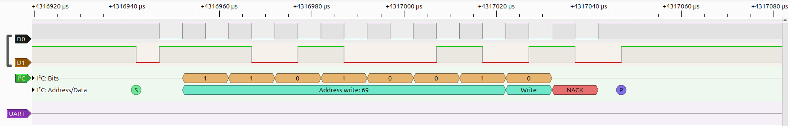

*Рис. 18 — відсутність ACK на адресному етапі при зверненні до `0x69`.*

Від START до STOP минає приблизно **105 мкс**. На відміну від NACK після останнього байта *успішного читання* (який формує контролер), тут **не відповідає адресований пристрій**. Прошивка виводить повідомлення з `error=NACK`; це контрольований тест відмови, а не несправність нормальної адреси `0x68`.

## 8. Підтвердження роботи системи та відтворення

Після самоперевірки прошивка продовжує паралельно читати MPU-6050, ADC та GPIO, а UART щосекунди друкує телеметрію. На скріншоті старту всі три пристрої мають `status=OK`:

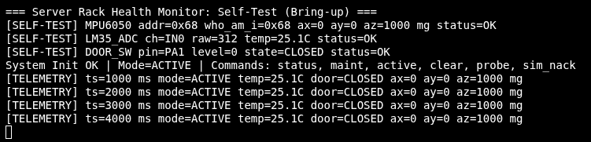

*Рис. 19 — початкова самоперевірка та нормальні показання в режимі ACTIVE.*

Під час окремого функціонального сценарію зареєстровано `SHOCK DETECTED`, `HIGH TEMPERATURE` та `DOOR OPENED`. Приклад підвищеної температури **259,0°C** отримано навмисно при зміні потенціометра; це **вихід за фізично правдоподібний робочий діапазон LM35**, але придатний для демонстрації порогового спрацювання саме програмної моделі. Після команди `maint` телеметрія продовжується у режимі `MAINT`, а нові тривоги не формуються, хоча вхідні умови залишаються тривожними.

[Скріншот трьох тривог](../lab_2/img/17_alarms.png) · [Режим обслуговування](../lab_2/img/18_maintenance.png) · [Результат хостових тестів і покриття](../lab_2/img/19_tests_coverage.png)

Для повторення досліду достатньо зібрати актуальну прошивку (`make build` у корені проєкту), відкрити Wokwi та запустити симуляцію. На старті автоматично виконуються `WHO_AM_I`, ініціалізація MPU, початкове читання прискорення й ADC. Команда `probe` повторно читає ID і шість байтів прискорення; `sim_nack` створює контрольоване звернення до відсутньої адреси. Кнопкою `door1` можна відтворити подію на D3; зміною `temp1` — поріг температури. Після зупинки симуляції VCD відкривається в PulseView з декодерами I²C (`SCL=D0`, `SDA=D1`) та UART (`RX=D2`, 115200, 8N1). Для окремого аналізу відмови зберігається другий запуск як `fault-nack.vcd`.

Архівні [`wokwi_archive.vcd`](wokwi_archive.vcd) і [`fault-nack_archive.vcd`](fault-nack_archive.vcd) залишено для історії, але **наведені тут числа та скріншоти стосуються нових записів без `_archive`**. Результати є вимірюваннями **цифрової моделі Wokwi**, не електричними вимірюваннями на реальній платі; з них не можна оцінити, наприклад, аналогову форму фронтів, шум або точність реального LM35.

## Висновок

Аналіз записів підтвердив коректний обмін із MPU-6050 за адресою `0x68`, успішну ініціалізацію датчика та правильне читання даних прискорення. Декодовані байти узгоджуються з показаннями UART і тестовим вектором драйвера. Виміряна частота SCL становить 100 кГц, а часові параметри UART та період опитування ADC відповідають програмним налаштуванням.

Додатково встановлено, що тривалість операцій залежить не лише від швидкості інтерфейсів, а й від програмних затримок та викликів HAL. Окремий запис із командою `sim_nack` підтвердив можливість відтворення й аналізу помилки адресації I²C.

### Використані матеріали

1. [Pinout і розрахунок параметрів інтерфейсів](../pinout.md) — теоретичні частоти й таймінги, адресація, схема підключення.
2. [MPU-6000/MPU-6050 Register Map and Descriptions, Rev. 4.2](https://invensense.tdk.com/wp-content/uploads/2015/02/MPU-6000-Register-Map.pdf) — регістри `0x75`, `0x3B–0x40`, `0x6B`, `0x1A`, `0x19`, `0x1C` та масштаб ±2g.
3. [Wokwi Logic Analyzer Guide](https://docs.wokwi.com/guides/logic-analyzer) — формат VCD та імпорт у PulseView.
4. Власні файли [`wokwi.vcd`](wokwi.vcd), [`fault-nack.vcd`](fault-nack.vcd) і скріншоти у [`docs/lab_2/img`](../lab_2/img/) — первинні результати ЛР2.
