# Лабораторна робота № 2

**Тема:** Інтеграція сенсорної підсистеми: схема підключення, верифікація інтерфейсів логічним аналізатором, архітектура програмного проєкту.  
**Виконав:** студент групи ІО-36, Лазінько Р. С.   
**Форма виконання:** В (Wokwi)   

## Мета роботи

Метою лабораторної роботи було об'єднати заплановані в ЛР1 датчики в одну систему моніторингу серверної стійки, перевірити їхню сумісність та працездатність і підтвердити роботу інтерфейсів не лише повідомленнями прошивки, а й записами логічного аналізатора. Окремими завданнями стали розрахунок параметрів підключення, розділення прошивки на незалежні модулі, створення хостових тестів та автоматизація збірки.

Роботу виконано в симуляторі Wokwi за формою B. Такий підхід дозволив записати I²C, UART і цифрові сигнали у форматі VCD та проаналізувати їх у PulseView. Фізичні електричні характеристики реальної плати при цьому не вимірювалися.

## Хід роботи

### 1. Схема підключення та обґрунтування архітектурних рішень

За основу взято проєкт **Server Rack Health Monitor** із ЛР1. Для контролю фізичного стану серверної стійки використано MPU-6050, аналоговий температурний вхід і кінцевий вимикач дверцят. Пристрої працюють одночасно під керуванням однієї прошивки STM32C031C6.

Для акселерометра обрано **I²C1**: MPU-6050 має регістровий інтерфейс, а для передавання трьох осей прискорення достатньо стандартної швидкості 100 кГц. Лінії PA9 (`SCL`) і PA10 (`SDA`) налаштовані як альтернативні open-drain; кожна має зовнішню підтяжку **4,7 кОм до 3V3**. Вивід `AD0` з'єднано із землею, тому адреса MPU-6050 становить `0x68`. Регістр ідентифікації `WHO_AM_I` розташований за адресою `0x75`, очікуване значення — `0x68`.

Температуру отримує канал **ADC1_IN0 на PA0**. У Wokwi аналоговий вихід LM35 емулює потенціометр `temp1` із живленням 3,3 В. На реальному стенді LM35 потребує окремої лінії живлення 5 В (від плати Nucleo), спільної землі та перевірки допустимої напруги на вході ADC. Кінцевий вимикач підключено до **PA1** із внутрішнім `GPIO_PULLDOWN`: у вихідному стані вхід має LOW, під час замикання на 3V3 — HIGH. Під час обробки використовується програмний debounce 50 мс.

Для повідомлень і команд застосовано **USART2, PA2/PA3, 115200 бод, 8N1**, із можливістю роботи через віртуальний COM-порт. Бортовий світлодіод `LD4` керується через **PA5**. Вільний GPIO **PA4** відведено під маркер `ADC_CONV_MARK`, щоб у VCD було видно моменти запуску та завершення процедури читання ADC.

| Сигнал STM32 | Підключення / призначення |
|---|---|
| PA9 / PA10 | MPU-6050: I²C1 SCL / SDA, зовнішні підтяжки 4,7 кОм |
| PA0 | `temp1:SIG`, аналогова модель LM35, ADC1_IN0 |
| PA1 | `door1`, цифровий вхід із Pull-Down |
| PA2 / PA3 | USART2 TX / RX, журнал і команди |
| PA4 | Службовий строб ADC для логічного аналізатора |
| PA5 | Бортовий LED `LD4` |

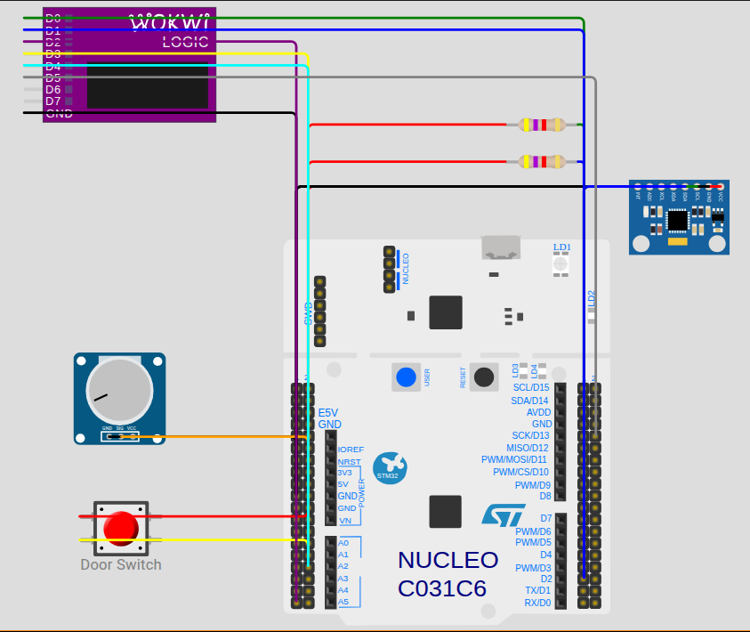

*Рис. 1 — спільна схема STM32C031C6, MPU-6050, потенціометра, кнопки, резисторів підтяжки та логічного аналізатора.*

Перевірено, що призначення виводів не конфліктують із лініями налагодження SWD та бортовим UART. Раніше розглядалися інші варіанти: використання PA3/PA5 для вимикача, переставлення PA9 і PA10 між SCL/SDA, а також використання PA13/PA14 як маркера. Від них відмовилися через зайнятість виводів та вимогу зберегти відповідність апаратним функціям. Повна pinout-таблиця з AF, роз'ємами Nucleo, джерелами, розрахунком тактування й відхиленими альтернативами наведена в [docs/pinout.md](pinout.md).

Теоретичний бюджет лінії **3V3 у моделі** становить **11,08 мА** типового та **22,18 мА** пікового споживання. За прийнятої в `pinout.md` оцінки доступного струму 500 мА розрахунковий запас складає **477,82 мА**. Це розрахунок за характеристиками компонентів, **не вимірювання струму** у Wokwi; реальний LM35 (близько 60 мкА від 5 В) до бюджету симуляції 3V3 не входить.

### 2. Ініціалізація пристроїв та робота системи

Після `HAL_Init()`, налаштування тактування і периферії `main.c` викликає `Platform_Init()`. На старті прошивка перевіряє MPU-6050, зчитує температуру через ADC і визначає початковий стан вимикача. Вивід організовано через UART. Для поточного нормального запуску отримано:

```text
[SELF-TEST] MPU6050 addr=0x68 who_am_i=0x68 ax=0 ay=0 az=1000 mg status=OK
[SELF-TEST] LM35_ADC ch=IN0 raw=312 temp=25.1C status=OK
[SELF-TEST] DOOR_SW pin=PA1 level=0 state=CLOSED status=OK
System Init OK | Mode=ACTIVE
```

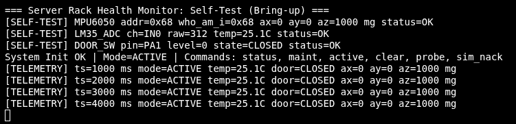

*Рис. 2 — початкова самоперевірка всіх трьох входів системи.*

Значення прискорення `X=0`, `Y=0`, `Z=1000 mg` відповідають прискоренню вільного падіння **1g за модулем** для нерухомого датчика. Таким чином, відхилення показника від очікуваного значення в цьому симуляційному стані становить 0%. Початкове значення `raw=312` дає **25,1°C**; це правдоподібна початкова температура й вона нижча від програмного порога тривоги **45°C**. Для вимикача значення `level=0` означає зачинені дверцята.

Основний цикл опитує MPU-6050 та ADC з номінальним періодом **20 мс**, а телеметрію виводить щосекунди. Рішення про тривогу приймається в `App/rack_monitor.c`: удар визначається за відхиленням модуля прискорення від 1g; підвищена температура — за перевищенням 45°C; відкриття дверцят — після фільтрації зміни рівня протягом 50 мс. Повторні тривоги від одного джерела обмежені інтервалом **5 с**.

Під час окремого функціонального сценарію у Wokwi отримано всі три повідомлення: `SHOCK DETECTED`, `HIGH TEMPERATURE` та `DOOR OPENED`. 

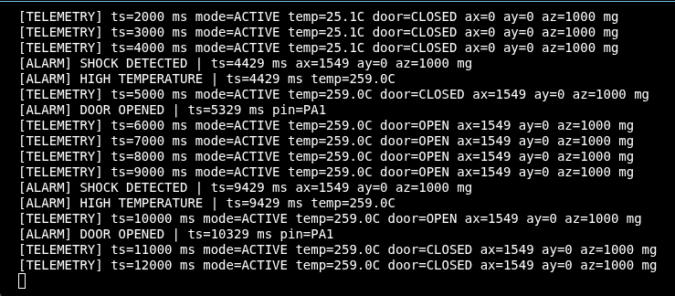

*Рис. 3 — підтвердження тривог за ударом, перегрівом і відкриттям дверцят.*

Команда `maint` переводить систему в режим обслуговування: надходження показників і щосекундна телеметрія продовжуються, але нові звичайні тривоги за ударом, температурою та дверцятами не формуються. Це перевірено навіть за збереження підвищеної температури та відкриття дверцят. Для повернення до охоронного режиму використовується команда `active`; доступні також `status`, `clear`, `probe` та `sim_nack`.

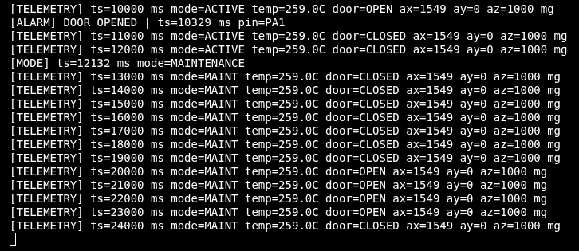

*Рис. 4 — робота режиму обслуговування без нових повідомлень `ALARM`.*

### 3. Аналіз записів логічного аналізатора

Для незалежної перевірки обміну записано два актуальні файли — [`wokwi.vcd`](captures/wokwi.vcd) і [`fault-nack.vcd`](captures/fault-nack.vcd). Перший містить нормальний запуск, конфігурацію MPU-6050, читання прискорення, UART, ADC і події дверцят. Другий призначено для контрольованої аномалії на I²C. Захоплення виконувалося компонентом Wokwi Logic Analyzer без окремо налаштованого апаратного тригера; аналіз робився після зупинки симуляції. Часова шкала VCD має одиницю 1 нс; у PulseView для імпорту застосовано `Downsampling factor = 100` (сітка 0,1 мкс). Докладні параметри записів, канали, текстові декодовані послідовності й скріншоти наведено в [docs/captures/analysis.md](captures/analysis.md).

#### 3.1. I²C — обмін із MPU-6050

Під час читання ідентифікатора зафіксовано передавання `0x68 W`, вибір регістра `0x75`, потім нову транзакцію `0x68 R` і відповідь `0x68`. Після цього записано конфігураційні команди `0x6B←0x00`, `0x1A←0x03`, `0x19←0x09`, `0x1C←0x00`. Багатобайтове читання з `0x3B` повернуло **`00 00 00 00 40 00`**, тобто `0`, `0` і `1000 mg` по осях X/Y/Z. Адресний байт `0xD0` та ACK додатково розібрано вручну за рівнями SDA/SCL.

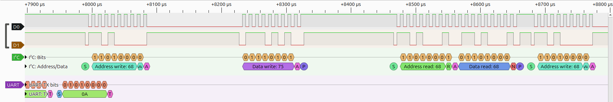

*Рис. 5 — ідентифікація MPU-6050 через регістр WHO_AM_I (0x75) з отриманням значення 0x68.*

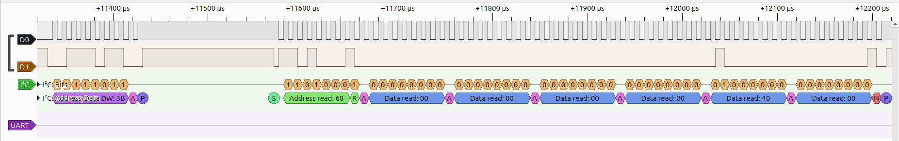

*Рис. 6 — шестибайтове читання прискорення з регістра `0x3B`.*

#### 3.2. UART — декодування повідомлень

Декодер UART на каналі D2 при налаштуванні 115200 бод, 8N1 показав текстові повідомлення прошивки. Результати декодування збігаються з UART-журналом Wokwi, зокрема з повідомленнями початкової самоперевірки.

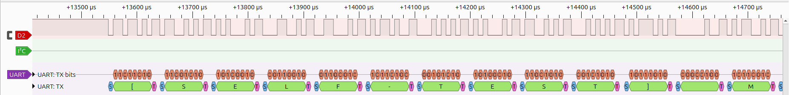

*Рис. 7 — декодування повідомлення SELF-TEST на лінії USART2_TX.* 

#### 3.3. ADC та GPIO — часові маркери й реакція системи

Для контролю роботи ADC використано службовий GPIO PA4, підключений до каналу D4 логічного аналізатора. Імпульси цього сигналу дозволяють визначити момент, період і тривалість процедури зчитування ADC без доступу до внутрішніх регістрів мікроконтролера.

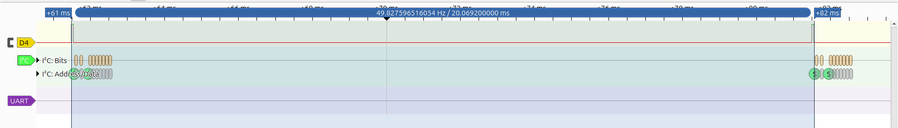

*Рис. 8 — вимірювання періоду між двома послідовними запусками процедури ADC.*

Окремо на каналі D3 зафіксовано зміну стану кінцевого вимикача дверцят. Порівняння цього сигналу з UART-виводом дозволило виміряти затримку між стабілізацією входу та початком повідомлення про відкриття дверцят.

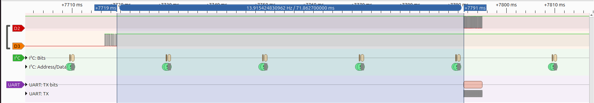

*Рис. 9 — вимірювання затримки від стабілізації сигналу дверцят до початку UART-повідомлення.*

#### 3.4. Порівняння часових параметрів

| Параметр | Розрахунок / задане значення | Виміряно |
|---|---:|---:|
| Частота SCL | 100 кГц | **100,0 кГц** |
| Читання `WHO_AM_I` разом з адресацією і паузами | ≈360 мкс активних 36 тактів без пауз | **671,3 мкс** |
| Пауза між `STOP` і наступним `START` | 120 мкс програмної затримки + витрати | **138,6 мкс** |
| Завершення маркера ADC → початок наступного I²C | Фіксований норматив відсутній | **19,275 мкс** |
| Тривалість UART-біта | ≈8,687 мкс | **8,700 мкс** |
| Період запуску ADC | 20,000 мс | **20,0692 мс** |
| Тривалість маркера ADC | ≈0,583 мкс для апаратного перетворення | **60,9 мкс** для всієї HAL-процедури |

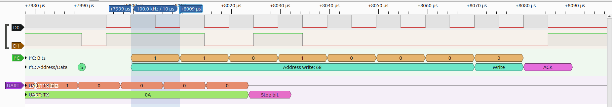

*Рис. 10 — період SCL 10 мкс, що відповідає частоті 100 кГц.*

Виміряна частота I²C становить **100 кГц** і відповідає розрахунку `I2C_TIMINGR`, наведеному в [pinout.md](pinout.md). Окрім частоти тактування, було виміряно повну тривалість читання ідентифікатора MPU-6050 та паузи між транзакціями.

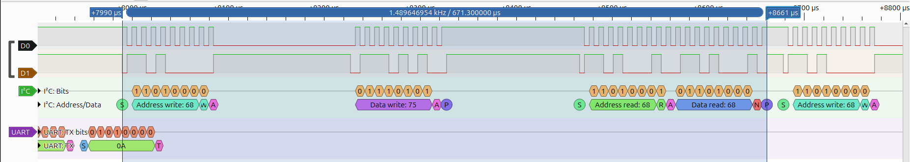

*Рис. 11 — повна тривалість операції читання WHO_AM_I — 671,3 мкс.*

Виміряна тривалість становить **671,3 мкс**, що перевищує розрахункові 360 мкс для 36 тактів SCL. Причиною є програмні затримки та додаткові операції адаптера I²C.

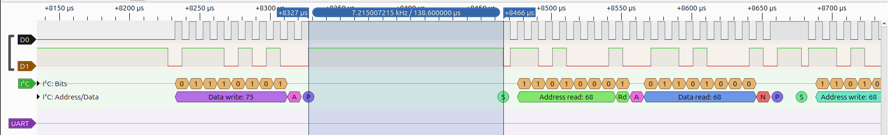

*Рис. 12 — інтервал між STOP запису регістра та наступним START читання — 138,6 мкс.*

Інтервал між послідовними транзакціями становить **138,6 мкс**. У `platform.c` передбачено програмну затримку 120 мкс, а решта часу припадає на додаткові операції прошивки.

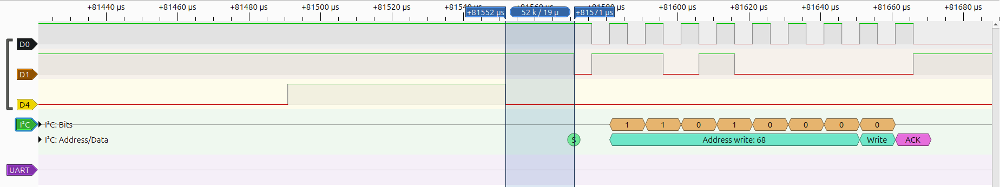

*Рис. 13 — затримка між завершенням процедури ADC та початком наступної I²C-транзакції — 19,275 мкс.*

Останнє вимірювання показує затримку **19,275 мкс** між спадним фронтом службового маркера PA4 та наступним START на шині I²C. Воно характеризує послідовність виконання програмного циклу, а не час реакції на зовнішню подію.

Період і тривалість процедури ADC наведено в таблиці часових параметрів; детальні вимірювання та осцилограми містяться в [analysis.md](captures/analysis.md). Реакцію на відкриття дверцят, включно із затримкою **71,86 мс** після стабілізації входу, уже показано на рис. 9.

#### 3.5. Контрольована аномалія NACK

Команда `sim_nack` звертається до неіснуючого у схемі пристрою за 7-бітною адресою `0x69`. Логічний аналізатор показує адресний байт `0xD2`, відсутність ACK і завершення транзакції STOP, а UART повідомляє `error=NACK`. Це очікувана контрольована відмова, на відміну від нормального NACK контролера після останнього байта звичайного читання.

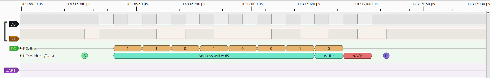

*Рис. 14 — відсутність підтвердження при зверненні до адреси `0x69`.*

### 4. Архітектура прошивки та збірка

Після ЛР1 код було розділено на чотири основні частини. `Core` містить CubeMX-ініціалізацію STM32, `Platform` працює з конкретними хендлами та периферією, `Devices` реалізує драйвер MPU-6050, а `App` — правила моніторингу й тривог. Бібліотеки ST HAL/CMSIS зберігаються у `Drivers`. Модулі `App` і `Devices` не включають STM32 HAL та можуть компілюватися звичайним GCC.

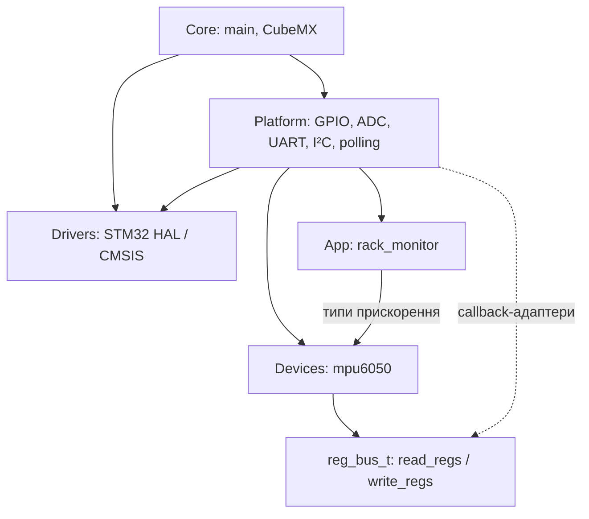

*Рис. 15 — спрощена схема компонентів і напрямків залежностей. Повна діаграма та опис контрактів містяться у [docs/architecture.md](architecture.md).*

Для незалежності драйвера використано `reg_bus_t` — структуру з контекстом і вказівниками `read_regs`/`write_regs`. У прошивці інтерфейс реалізується адаптерами в `Platform`, у тестах — функціями `fake_read` і `fake_write`. Перевірка `check-deps` із `tests/Makefile` контролює відсутність прямих заборонених включень HAL/Platform у `App` та `Devices`.

Робочі виклики в згенерованому `main.c` розміщено в секціях `USER CODE`. Окремий `firmware/GNUmakefile` зберігає підключення власних модулів у процесі збірки, навіть якщо згенерований `firmware/Makefile` зміниться після CubeMX. Конфігурацію PA4 також синхронізовано з `firmware.ioc`.

Кореневий `make build` запускає збірку в Docker на основі `ubuntu:22.04`; прошивка компілюється ARM GCC і формує `firmware.elf`, `firmware.hex` та `firmware.bin`. Для власних файлів застосовуються `-Wall` і `-Wextra`. У GitHub Actions окремо виконуються `make -C firmware all` та `make -C tests all`. Використані версії HAL/CMSIS зафіксовано разом із вихідними файлами в репозиторії; докладніше це обґрунтовано в [architecture.md](architecture.md).

### 5. Хостове тестування та CI

Для модулів `Devices` і `App` використано тести мовою C на основі `assert.h` та підмінної I²C-шини. Такий спосіб дозволив перевірити алгоритми без фізичної плати, хоча не замінює тестування HAL, електричних рівнів і часових характеристик реального обладнання. На хості перевіряються:

- перетворення сирих байтів MPU-6050 та відліків ADC у фізичні одиниці;
- `WHO_AM_I`, порядок чотирьох конфігураційних записів MPU-6050 та обробка неправильного ID;
- помилки шини `NACK` і `timeout`;
- шестибайтовий вектор **`00 00 00 00 40 00`** із логічного аналізатора, що має дати `0 / 0 / 1000 mg`;
- коректне визначення удару без хибної тривоги лише від дії гравітації;
- поріг перегріву, debounce 50 мс, cooldown 5 с, режими роботи та стан LED.

Команда `make -C tests all` спочатку виконує перевірку архітектурних залежностей, далі запускає тести й `gcov`. Отримані значення покриття **рядків коду**:

| Модуль | Покриття рядків |
|---|---:|
| `App/rack_monitor.c` | **89,42%** зі 104 рядків |
| `Devices/mpu6050.c` | **90,74%** із 54 рядків |
| **Разом** | **89,87%** зі 158 рядків |

Для навчального проєкту за орієнтир прийнято **не менше 80% покриття рядків власних тестованих модулів**. Він перевищений обома файлами. Такий поріг дозволяє перевірити основну логіку й помилки драйвера, залишаючи апаратно-залежні гілки для перевірки в симуляції та на платі. Поріг використовується для оцінювання результату.

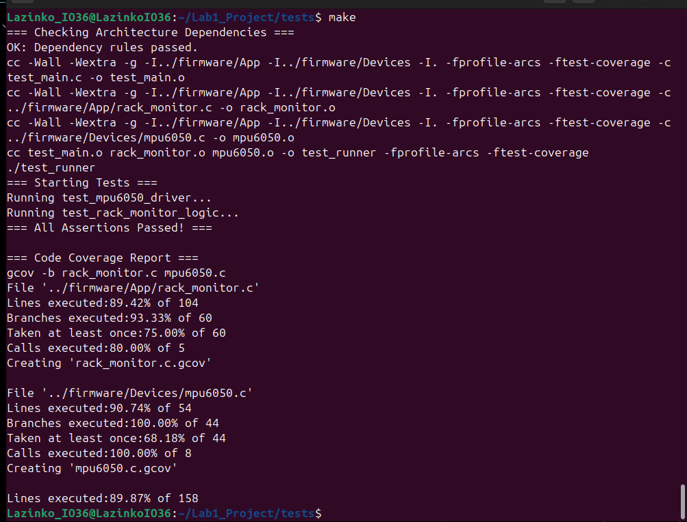

*Рис. 16 — успішні перевірки та звіт gcov із загальним покриттям 89,87%.*

Після відправлення змін у гілку `lab-2` GitHub Actions автоматично запустив `build-and-test`. Останній перевірений запуск на коміті [`bfccd8a`](https://github.com/in5436/Lab1_Project/commit/bfccd8a9a8af7e0c798f9f64e1f7b5208f478d71) завершився статусом **Success**; перевірялися збірка прошивки, host-тести, правило залежностей і формування покриття. [Перегляд запуску CI](https://github.com/in5436/Lab1_Project/actions/runs/40120556993).

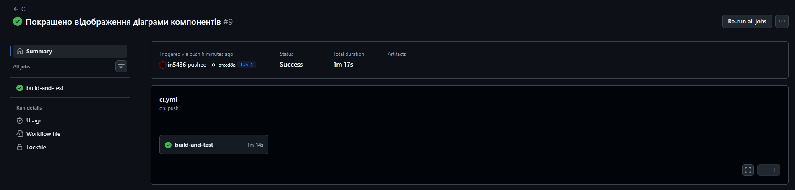

*Рис. 17 — успішний workflow `build-and-test` для гілки `lab-2`.*

### 6. Складнощі під час виконання та їх розв'язання

Нижче наведено фактичні проблеми, що виникали під час виконання ЛР2. Для кожної вказано симптом, причину й коміт, у якому було внесено відповідне виправлення.

**Проблема 1. Неправильне перетворення показників ADC у температуру.**  
**Симптом:** температура у вихідному коді обчислювалася з неправильним коефіцієнтом, тому показання не відповідали моделі вхідної напруги.  
**Причина:** у `rack_monitor_adc_to_deci_c()` використовувався множник `1000` замість `3300` для перетворення 12-бітного відліку за опорною напругою 3,3 В у десяті частки °C.  
**Виправлення:** змінено формулу та додано початкові хостові тести. [Коміт `e8392f2`](https://github.com/in5436/Lab1_Project/commit/e8392f22a2).

**Проблема 2. Несумісність версій GCC і gcov при формуванні покриття.**  
**Симптом:** локально `gcov` не міг коректно прочитати файли покриття, створені іншою версією GCC; примусове використання `gcov-9` усувало локальну помилку, але створювало проблему в GitHub Actions, де ця команда була недоступна.  
**Причина:** `tests/Makefile` жорстко викликав `gcov-9`, хоча збірка могла використовувати іншу версію компілятора.  
**Виправлення:** введено змінні `CC ?= gcc` і `GCOV ?= gcov`, щоб інструменти можна було узгодити з середовищем. Локальні інструменти також оновлено; у CI `actions/checkout` переведено на v4. [Коміт `9188ee1`](https://github.com/in5436/Lab1_Project/commit/9188ee1706).

**Проблема 3. Хибне визначення удару при нерухомому акселерометрі.**  
**Симптом:** при зміні орієнтації акселерометра система могла трактувати звичайні `1000 mg` уздовж однієї осі як удар.  
**Причина:** окрема перевірка перевищення X/Y порівнювала компоненти прискорення з порогом удару, не відрізняючи складову сили тяжіння.  
**Виправлення:** вилучено зайву перевірку окремих осей і залишено порівняння модуля прискорення з нормальним станом 1g; доповнено тести випадками «спокій на осі X» та «сильний удар». [Коміт `facd4ce`](https://github.com/in5436/Lab1_Project/commit/facd4ce490).

**Проблема 4. Невідповідність конфігурації GPIO та ризик втрати власних файлів після CubeMX.**  
**Симптом:** PA4 уже використовувався прошивкою як маркер ADC, але не був описаний у `firmware.ioc`; у згенерованому Makefile додавання власних `Platform`, `Devices`, `App` залежало від ручних правок.  
**Причина:** конфігурація CubeMX і ручні зміни вихідних файлів не були повністю синхронізовані.  
**Виправлення:** PA4 внесено в `.ioc` як GPIO Output; створено `firmware/GNUmakefile`, що зберігає підключення власних модулів до збірки. [Коміт `787acff`](https://github.com/in5436/Lab1_Project/commit/787acffaeb).

**Проблема 5. Нереалістична початкова температура у Wokwi.**  
**Симптом:** після запуску симуляції спрацьовувала температурна тривога, хоча її не планували для початкового стану.  
**Причина:** початкове значення потенціометра `temp1` було `250`, що відповідало завищеній температурі за прийнятою моделлю ADC.  
**Виправлення:** значення змінено на `78`; під час нового запуску самоперевірка показала `raw=312`, `temp=25.1C`, `status=OK`. [Коміт `fb1b7a7`](https://github.com/in5436/Lab1_Project/commit/fb1b7a78af).

**Проблема 6. Самоперевірка ADC могла повідомляти хибний успіх.**  
**Симптом:** під час старту `status=OK` для ADC виводився без урахування того, чи успішно закінчилися `HAL_ADC_Start()` та `HAL_ADC_PollForConversion()`.  
**Причина:** функція читання повертала лише число, причому `0` міг позначати як коректне вимірювання, так і помилку.  
**Виправлення:** функція почала окремо повертати успішність вимірювання, а стартовий звіт — виводити `FAIL` при помилці; невдале періодичне читання більше не підміняє попередній ADC-результат нулем. [Коміт `5b144d6`](https://github.com/in5436/Lab1_Project/commit/5b144d619a).

## Висновки

У лабораторній роботі вдалося об'єднати MPU-6050, аналогову модель LM35 і кінцевий вимикач в одній прошивці STM32C031C6. Стартова самоперевірка підтвердила працездатність компонентів, а функціональні сценарії — виявлення удару, перегріву й відкриття дверцят, роботу режиму обслуговування та обмеження повторних тривог.

Найважливішою частиною стала перевірка інтерфейсів на рівні сигналів. У PulseView декодовано адресу й регістри MPU-6050, прочитано шість байтів прискорення, вручну перевірено адресний байт і ACK та виміряно часові характеристики I²C, UART і маркера ADC. Частота SCL становила 100 кГц; решта вимірювань узгоджується з розрахунками та враховує програмні затримки. Штучно створена аномалія NACK показала, як помилка адресації відображається одночасно на шині та в UART.

Відокремлення `App` і `Devices` від HAL дозволило запустити хостові тести без плати. Для цих модулів отримано **89,87% покриття рядків**, а GitHub Actions успішно зібрав прошивку й виконав перевірки. Таким чином, проєкт підготовлено до подальшого розвитку на основі підтвердженої цифрової моделі; електричні характеристики й поведінка реальних сенсорів залишаються предметом окремої фізичної перевірки.

## Матеріали

1. [Репозиторій Server Rack Health Monitor, гілка `lab-2`](https://github.com/in5436/Lab1_Project/tree/lab-2).
2. [Відеозвіт](https://drive.google.com/file/d/1L9l5LwzKF6M3TruYsQgvgRzTYw87alR4/view?usp=sharing).
3. [Pinout, електричні параметри та розрахунки](pinout.md).
4. [Архітектура, діаграма компонентів і правила залежностей](architecture.md).
5. [Аналіз записів PulseView та виміряних параметрів](captures/analysis.md); [основний VCD](captures/wokwi.vcd); [VCD аномалії NACK](captures/fault-nack.vcd).
6. [Продуктові вимоги (PRD)](PRD.md); [аналіз апаратних компонентів](hardware-components.md).
7. [STM32C031C6 — технічні матеріали STMicroelectronics](https://www.st.com/en/microcontrollers-microprocessors/stm32c031c6.html): datasheet **DS13867**, reference manual **RM0490**; посилання на таблиці — у `pinout.md`.
8. [NUCLEO-C031C6 — сторінка плати STMicroelectronics](https://www.st.com/en/evaluation-tools/nucleo-c031c6.html), user manual **UM2953**.
9. [MPU-6000/MPU-6050 Register Map and Descriptions](https://invensense.tdk.com/wp-content/uploads/2015/02/MPU-6000-Register-Map1.pdf), Rev. 4.2; [MPU-6000/MPU-6050 Datasheet](https://invensense.tdk.com/wp-content/uploads/2015/02/MPU-6000-Datasheet1.pdf).
10. [Texas Instruments LM35 Datasheet](https://www.ti.com/lit/ds/symlink/lm35.pdf).
11. [Wokwi — документація логічного аналізатора](https://docs.wokwi.com/guides/logic-analyzer); [налаштування проєктів Wokwi для VS Code](https://docs.wokwi.com/vscode/project-config).

