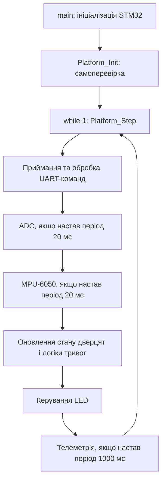
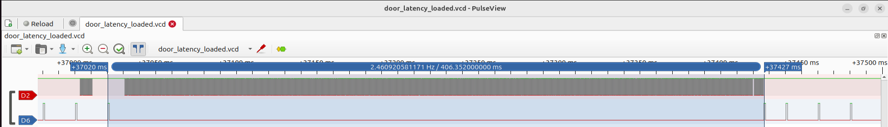
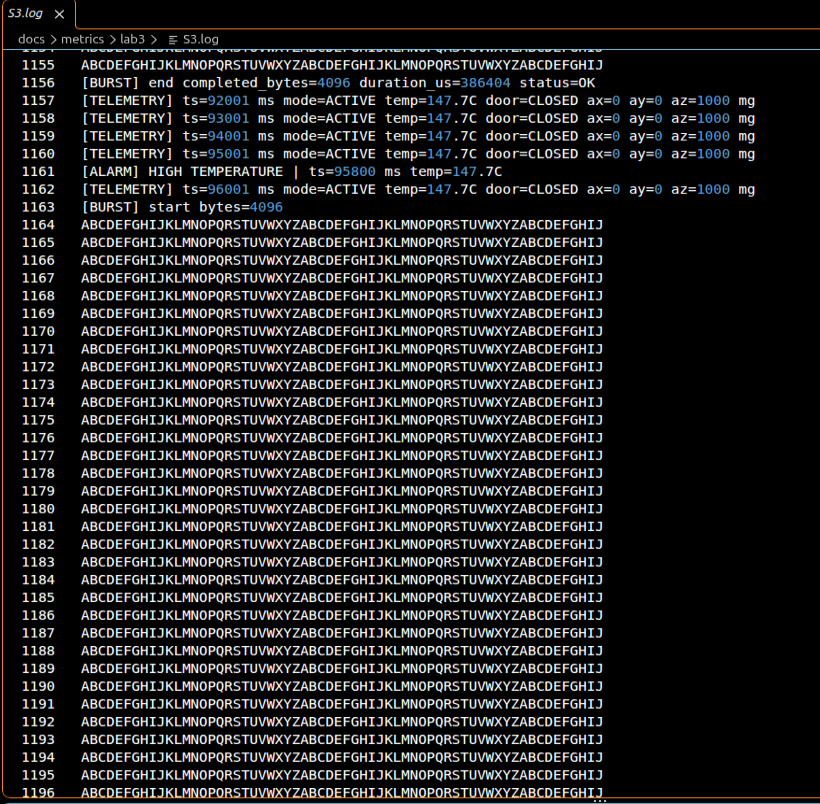
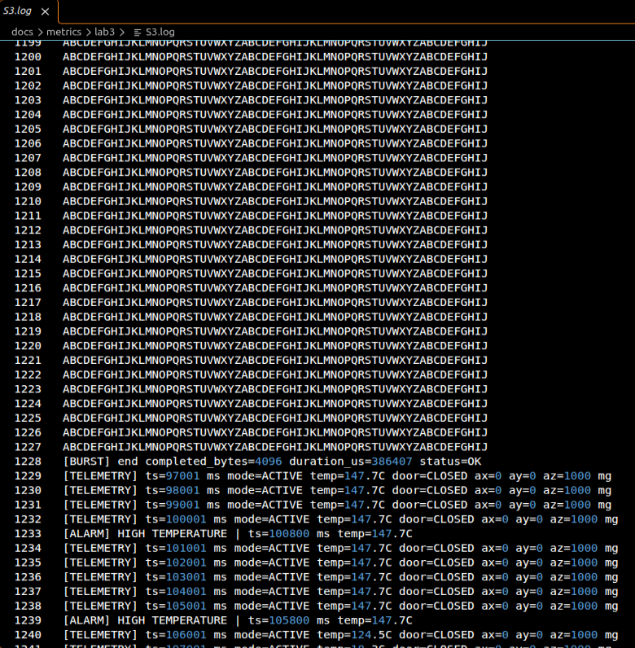
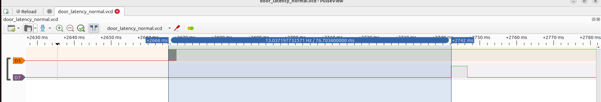
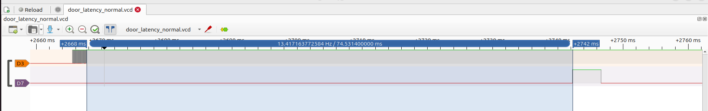
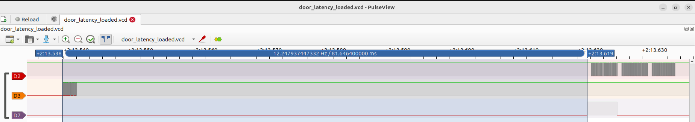
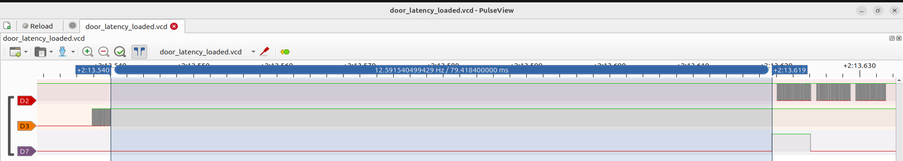
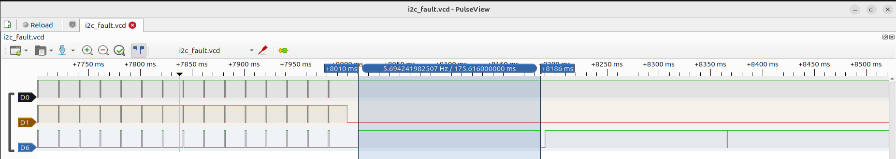
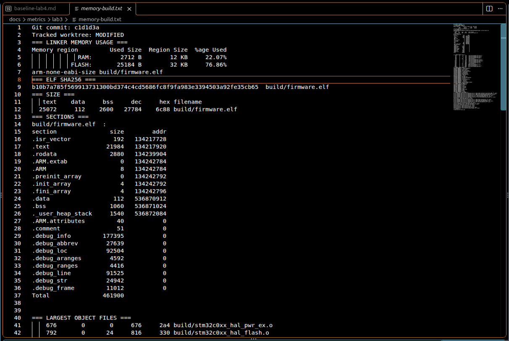

# Лабораторна робота № 3
 
**Тема:** Реалізація вимог продукту на bare metal (super loop): вимірювання швидкодії та пам'яті, пошук меж підходу  
**Виконав:** студент групи ІО-36, Лазінько Р. С.  
**Форма виконання:** B, симулятор Wokwi

## Мета роботи

Метою лабораторної роботи було завершити інтеграцію системи моніторингу серверної стійки в одній прошивці STM32 без операційної системи та дослідити, наскільки добре модель super loop виконує задачі з різними часовими вимогами. На відміну від ЛР2, де основну увагу приділяли роботі окремих інтерфейсів, у цій роботі потрібно було перевірити поведінку цілого продукту під час звичайного і підвищеного навантаження.

Окремими завданнями стали вимірювання часу виконання задач, джитера, затримки реакції та використання пам'яті, перевірка відмов і пошук меж архітектури. Отримані результати мають стати базовою лінією для порівняння з FreeRTOS у ЛР4.

## Хід роботи

### 1. Стенд, структура прошивки та організація super loop

За основу взято Server Rack Health Monitor із попередніх лабораторних робіт. Прошивка працює на STM32C031C6 з ядром Cortex-M0+ і тактовою частотою 48 МГц. Система отримує прискорення від MPU-6050 через I²C1, температуру через ADC1_IN0 та стан дверцят через цифровий вхід PA1. У Wokwi датчик LM35 моделюється потенціометром `temp1`. Для обміну з користувачем застосовано USART2 зі швидкістю 115200 бод, 8N1.

Основна прикладна логіка залишилася з ЛР2. У `App/rack_monitor.c` реалізовано визначення удару за відхиленням модуля прискорення від 1g, поріг перегріву 45°C, фільтрацію дребезгу дверцят 50 мс, два режими роботи та обмеження повторних тривог одного джерела інтервалом 5 с. Шар `Devices` відповідає за MPU-6050, `Platform` за периферію, команди, планування опитувань і вимірювання, а `Core` за ініціалізацію STM32.

Після `Platform_Init()` головна функція безперервно викликає `Platform_Step()`. Операції виконуються послідовно, без FreeRTOS і без окремих стеків задач. Періодичність визначається через `HAL_GetTick()`, тому довга блокувальна операція може відкласти наступний запуск інших задач.

*Рис. 1. Послідовність роботи основного циклу прошивки Server Rack Health Monitor.*

| Задача | Період або умова | Вимога до роботи |
|---|---|---|
| Приймання UART-команд | Кожен прохід циклу | Обробка команд `status`, `maint`, `active` та вимірювальних команд |
| ADC, температура | 20 мс | Вимірювання не рідше ніж раз за 1 с |
| MPU-6050 | 20 мс | Не менше 10 вимірювань за секунду |
| Дверцята та тривожна логіка | Після оновлення даних датчиків | Debounce 50 мс, повідомлення про подію, cooldown 5 с |
| LED | Кожен прохід циклу | Індикація ACTIVE, MAINTENANCE або тривоги |
| Телеметрія | 1000 мс | Періодичний вивід стану через UART |

Для відліку мілісекунд використовується SysTick. Додатково в ЛР3 застосовано переривання TIM3, яке розширює 16-бітний лічильник для мікросекундних вимірювань. Приймання UART і стан дверцят обробляються опитуванням, без окремих прикладних ISR; DMA для передачі UART не використовується. Блокувальний `HAL_UART_Transmit()` та очікування прапорців I²C залишено навмисно, оскільки саме їхній вплив на решту задач потрібно дослідити.

Повний перелік задач, відповідність FR і часові критерії наведено в [tasks.md](tasks.md), а шарову архітектуру описано в [architecture.md](architecture.md).

### 2. Перевірка функціональних вимог PRD

Перед вимірюванням швидкодії перевірено, чи збереглася функціональність продукту. У звичайному запуску MPU-6050 повертає `WHO_AM_I=0x68` і прискорення `0, 0, 1000 mg`, температурний канал показує близько 25,1°C, дверцята зачинені. У журналах також наявні повідомлення про удар, перегрів, відкриття дверцят та перемикання режимів.

Статуси нижче стосуються фактично перевірених сценаріїв, а не всіх можливих ситуацій на реальному обладнанні. Позначка «з обмеженням» означає, що основну поведінку реалізовано, але під навантаженням або при відмові виявлено суттєву межу.

| FR | Стан | Підтвердження та обмеження |
|---|---|---|
| FR-01, стартова ініціалізація | З обмеженням | У нормальному запуску самоперевірка успішна. Якщо MPU-6050 недоступний під час старту, виводиться `FAIL`; автоматичне відновлення без перезапуску не підтверджене. [Запуск із відмовою](metrics/lab3/boot_sensor_not_ready.log). |
| FR-02, акселерометр не менше 10 Гц | З обмеженням | У S1 і S2 опитування відбувається з номінальним періодом 20 мс. У S3 максимум 416,468 мс і 509 пропущених запусків. [Періоди](metrics/lab3/analysis/periods.csv). |
| FR-03, температура не рідше 1 разу за секунду | Виконана в перевірених сценаріях | ADC працює з номінальним періодом 20 мс, навіть у S3 найбільший виміряний інтервал 416,455 мс. У S3 зафіксовано `HIGH TEMPERATURE`. [Журнал S3](metrics/lab3/S3.log). |
| FR-04, реакція на відкриття дверцят | З обмеженням | Події виявляються після debounce. За тестом без cooldown затримка PA1 до PA7 становила 61,205-81,496 мс у звичайному режимі та 64,171-81,649 мс під навантаженням; дві з 50 навантажених спроб не мали окремої реакції. [Вимірювання](captures/lab3/door_latency_loaded_samples.csv). |
| FR-05, UART-тривога з причиною і часом | З обмеженням | У логах наявні тривоги трьох типів із `ts`. Блокувальна передача та пропуски опитування обмежують своєчасність повідомлень. [S3](metrics/lab3/S3.log), [обмеження](limitations.md). |
| FR-06, ACTIVE та MAINTENANCE | З обмеженням | Режими працюють, у MAINTENANCE звичайні тривоги не формуються, телеметрія продовжується. Під час потоку команд приймання UART ненадійне. [S2](metrics/lab3/S2.log), [тест UART](metrics/lab3/uart_flood-summary.csv). |
| FR-07, індикація LED | Виконана в реалізації та перевірених тестах | У коді передбачені швидке блимання для ACTIVE, повільне для MAINTENANCE та постійне світіння після зафіксованої тривоги. [Реалізація](../firmware/App/rack_monitor.c). |
| FR-08, debounce 50 мс | Виконана в перевірених сценаріях | Стан дверцят підтверджується після програмної фільтрації; фізичний фронт і момент реакції видно у VCD. [VCD](captures/lab3/door_latency_normal.vcd). |
| FR-09, cooldown 5 с | Виконана в перевірених сценаріях | Повторні тривоги одного джерела обмежуються п'ятьма секундами. У вимірюваннях затримки окремо враховано спрацювання, на які впливав cooldown. [CSV](captures/lab3/door_latency_normal_samples.csv). |

Таким чином, основні функції продукту працюють в одній прошивці, проте вимога FR-02 не гарантується під максимальним навантаженням. Виявлені обмеження збережені як предмет дослідження super loop.

### 3. Методика вимірювань

На STM32C031C6 використано апаратний TIM3 із кроком 1 мкс. Модуль `firmware/Platform/perf.c` збирає для кожної задачі кількість викликів, мінімальний, середній і максимальний час виконання, фактичний період, найбільший абсолютний джитер, кількість пропущених запусків та порушень дедлайнів. Переповнення 16-бітного таймера враховує обробник TIM3. Оскільки використано Cortex-M0+, приклад DWT CYCCNT для Cortex-M4 із методички безпосередньо не застосовувався.

Результати прошивка передає через UART у повідомленнях `[TASK]`, `[PERIOD]`, `[STATS]`, `[LOAD]`, `[MEM]`, `[BURST]` та `EVT`. Для часових висновків беруться значення лічильника мікроконтролера, а не момент отримання рядка комп'ютером. Хостовий скрипт `tools/analyze_lab3.py` обробляє журнали та створює підсумкові CSV. В усіх трьох основних сценаріях однакові ідентифікатор прошивки `c1d1d3a82c1e`, частота 48 МГц і UART 115200 бод.

Незалежним способом перевірки став логічний аналізатор Wokwi. Для ЛР3 до вже наявних каналів додано D6, тобто PA6 як маркер виконання задачі IMU, та D7, тобто PA7 як маркер початку реакції на відкриття дверцят. D3 показує фізичний стан PA1, D2 передавання UART, D0 і D1 сигнали I²C. Записи збережено у форматі VCD та переглянуто в PulseView. У симуляції курсори використовувалися для визначення інтервалів між фронтами й ширини імпульсів.

Окремо для пам'яті використано `--print-memory-usage`, `arm-none-eabi-size`, `arm-none-eabi-nm`, map-файл, `-fstack-usage` та заповнення вільної частини стека шаблоном. Показник `work_min_pct` відображає лише нижню оцінку часу інструментованих операцій, тому він не прирівнюється до повного завантаження процесора.

### 4. Сценарії S1, S2, S3 та часові результати

Випробування проведено за трьома основними сценаріями. У S1 сенсори перебували у спокої, температура становила близько 25,1°C, дверцята були зачинені. У S2 протягом годинного прогону працювали всі датчики, звичайна телеметрія та поодинокі команди, зокрема перемикання в MAINTENANCE і назад. У S3 до цих операцій додавалися передачі `load 4096`, команди через UART та тривожні події, створені у Wokwi.

| Параметр | S1, простій | S2, номінальний | S3, навантажений |
|---|---:|---:|---:|
| Вікно накопиченої статистики, с | 55,280 | 3598,920 | 178,999 |
| Кількість викликів ADC | 2764 | 179950 | 8441 |
| Кількість викликів IMU | 2764 | 179950 | 8441 |
| Пропущені запуски IMU | 0 | 0 | 509 |
| Пропущені запуски ADC | 0 | 0 | 509 |
| Нижня оцінка виміряної роботи CPU, % | 7,0 | 7,0 | 12,7 |
| Оцінена глибина стека, байт | 672 | 672 | 696 |
| `heap_brk_used`, байт | 1468 | 1468 | 1468 |

Основні результати часу виконання задач у форматі `min / avg / max`, мкс:

| Задача | S1 | S2 | S3 |
|---|---:|---:|---:|
| UART-команда | не викликалася | 108 / 7609 / 14136 | 102 / 314889 / 396522 |
| ADC | 72 / 72 / 76 | 71 / 72 / 78 | 72 / 72 / 78 |
| IMU | 1071 / 1073 / 1076 | 1071 / 1073 / 1079 | 1071 / 1073 / 1077 |
| Логіка тривог | 71 / 71 / 75 | 68 / 71 / 78 | 68 / 89 / 13363 |
| LED, виміряні виклики | 28 / 33 / 40 | 28 / 40 / 50 | 13 / 17 / 38 |
| Телеметрія | 9123 / 9140 / 9152 | 9016 / 9354 / 9412 | 8942 / 9259 / 9582 |
| Головний цикл | 44 / 57 / 10615 | 44 / 65 / 15571 | 28 / 43 / 397973 |

Для головного циклу `LOOP_SAMPLE` характеризує тривалість проходу `Platform_Step()`. Оскільки `main()` одразу викликає цю функцію повторно, ця тривалість практично визначає й інтервал між початками сусідніх проходів циклу, за винятком невеликих накладних витрат самого виклику.

Для аналізу періодичності особливо важливий не середній інтервал, а найбільший. Середнє значення може залишатися близьким до запланованих 20 мс навіть тоді, коли поодинокі блокування затримують роботу сенсора на сотні мілісекунд.

| Метрика | S1 | S2 | S3 |
|---|---:|---:|---:|
| IMU, середній період, мс | 19,999 | 19,999 | 21,205 |
| IMU, найбільший період, мс | 29,254 | 32,634 | 416,468 |
| IMU, максимальний джитер, мс | 9,254 | 13,813 | 396,468 |
| ADC, найбільший період, мс | 30,473 | 32,629 | 416,455 |
| ADC, максимальний джитер, мс | 10,473 | 13,815 | 396,455 |
| Телеметрія, максимальний джитер, мс | 1,447 | 1,463 | 1,435 |

За результатами S3 максимальний джитер IMU зріс відносно S1 на **387,214 мс**, а найдовший інтервал між опитуваннями IMU досяг **416,468 мс**. Це більше ніж 100 мс, які відповідають мінімальній частоті 10 Гц із FR-02. Лічильник `missed` зафіксував 509 пропущених планових запусків IMU; окремий лічильник `deadline_miss` у цьому прогоні становив 1. Ці два показники мають різні правила підрахунку й не підміняють один одного.

Під час довгої передачі UART у PulseView окремо виміряно інтервал близько **406,352 мс** між початками сусідніх імпульсів D6. Він показує, як відкладалося чергове опитування MPU-6050, поки UART займав головний цикл.

*Рис. 2. Порушення періодичності задачі MPU-6050 під час UART-навантаження. D2 показує передавання, D6 позначає виконання IMU; виміряний інтервал 406,352 мс.*

Під час тесту S3 команда `load 4096` передавала 4096 байтів блокувальними викликами UART. За журналом одна з передач тривала **386407 мкс**, а в серії передавань результати становили приблизно 386,3-386,4 мс. Теоретично для UART 115200 бод, 8N1 передавання одного байта потребує 10 біт. Для 4096 байтів розрахунок має вигляд: **t = (4096 × 10) / 115200 ≈ 0,35556 с = 355,56 мс**.

Фактична тривалість близько **386,4 мс** перевищує розрахунок приблизно на **8,7%**. Різниця пов'язана з накладними витратами послідовних блокувальних викликів, виконанням коду та особливостями моделі UART у Wokwi. Під час цієї операції інші задачі foreground не отримують керування своєчасно.

*Рис. 3. Сценарій S3: повідомлення про перегрів та запуск передавання `load 4096`.*

*Рис. 4. Завершення довгої передачі з результатом `completed_bytes=4096`, `duration_us=386407`, `status=OK`.*

Повні результати наведено у [tasks.csv](metrics/lab3/analysis/tasks.csv), [periods.csv](metrics/lab3/analysis/periods.csv), [comparison.csv](metrics/lab3/analysis/comparison.csv) та [bursts.csv](metrics/lab3/analysis/bursts.csv). Вони обчислені з оригінальних журналів, а не з округлених значень на рисунках.

### 5. Затримка реакції на відкриття дверцят

Для незалежного вимірювання затримки використано фізичний вхід PA1 на каналі D3 та маркер початку реакції PA7 на D7. Від першого фронту D3 до початку імпульсу D7 вимірюється повна затримка, яка містить очікування до чергового опитування та програмну фільтрацію дребезгу. Додатково зроблено вимірювання від завершення коротких коливань контакту, щоб окремо показати їхній вплив на часову шкалу. Це друге вимірювання не слід плутати із завершенням програмного debounce 50 мс.

*Рис. 5. Звичайний режим. Від першої зміни PA1 до початку маркера PA7 виміряно 76,7036 мс.*

*Рис. 6. Той самий випадок після початкових коливань контакту: 74,5314 мс до початку PA7.*

*Рис. 7. Навантажений режим, спрацювання №25. Від фізичного фронту PA1 до початку реакції PA7 виміряно 81,6464 мс; у CSV наведено 81,649 мс з точністю початкового VCD.*

*Рис. 8. Те саме навантажене спрацювання після коротких коливань контакту: 79,4184 мс до початку PA7. На обох рисунках D2 додатково показує активність UART без декодування байтів.*

Замість висновку за одним випадком виконано серію вимірювань. У звичайному режимі записано **42 спроби**, а під навантаженням **50 спроб**, із яких 48 мали окремий імпульс реакції. Через передбачений PRD інтервал 5 с між повторними тривогами частина спрацювань обмежувалася cooldown, тому для оцінки власне часу реакції результати без цього впливу виділено окремо.

| Показник | Звичайний режим | Під навантаженням |
|---|---:|---:|
| Спроб відкриття | 42 | 50 |
| Зафіксованих реакцій PA7 | 42 | 48 |
| Реакцій без впливу cooldown | 29 | 12 |
| Мінімальна затримка без cooldown, мс | 61,205 | 64,171 |
| Максимальна затримка без cooldown, мс | 81,496 | 81,649 |
| Найбільша затримка серед усіх зафіксованих реакцій, мс | 743,232 | 564,844 |

У випадках з активним cooldown велика затримка не дорівнює часу блокування головного циклу: повторне повідомлення може чекати закінчення п'ятисекундного інтервалу. Водночас **дві спроби під навантаженням не мали окремої реакції**, тому вважати поведінку дверцят безумовно надійною не можна. Таблиці з кожним виміром збережено як [door_latency_normal_samples.csv](captures/lab3/door_latency_normal_samples.csv) та [door_latency_loaded_samples.csv](captures/lab3/door_latency_loaded_samples.csv).

### 6. Додаткові випробування та пошук точки зламу

Окрім S1-S3, перевірено поступове збільшення навантаження, потік команд, відмову I²C, тривалу роботу, запуск і перезапуск із недоступним датчиком. Ці сценарії потрібні, щоб відокремити нормальну роботу продукту від ситуацій, де одна задача затримує інші.

| Випробування | Фактичний результат | Джерело |
|---|---|---|
| Пошук точки зламу | Уже за передачі 256 байтів UART зафіксовано 7 пропущених запусків IMU у відповідному етапі; для 4096 байтів 130. | [breakpoint.log](metrics/lab3/breakpoint.log), [дії](metrics/lab3/breakpoint-actions.csv) |
| Потік UART-команд | На 20 контрольних `status` отримано 19 відповідей; із 100 команд у потоці без додаткового навантаження 11, із 100 під час довгої передачі 1. | [uart_flood-summary.csv](metrics/lab3/uart_flood-summary.csv) |
| Відмова I²C під час роботи | Максимальний час задачі IMU 175,623 мс, максимальний джитер IMU 343,947 мс, по 355 пропущених запусків ADC та IMU. | [i2c_fault.log](metrics/lab3/i2c_fault.log), [VCD](captures/lab3/i2c_fault.vcd) |
| Тривала робота | Під час приблизно годинного S2 пропущених запусків ADC та IMU не зафіксовано, `heap_brk_used` залишався 1468 байтів у збережених контрольних точках. | [S2.log](metrics/lab3/S2.log) |
| Старт і перезапуск | У нормальному запуску перша вибірка MPU-6050 на 17-й мс, ADC на 30-й мс від HAL-відліку. Без SDA MPU-6050 показав `FAIL`, решта телеметрії продовжувала працювати; після відновлення схеми й перезапуску самоперевірка стала успішною. | [boot-reboot.log](metrics/lab3/boot-reboot.log), [boot_sensor_not_ready.log](metrics/lab3/boot_sensor_not_ready.log) |

*Випробування довгої UART-передачі одночасно з періодичним опитуванням датчиків, а також реакції на подію під час навантаження детально розглянуто в розділах 4 і 5 відповідно.

Під час UART-flood лічильник `uart_rx_overrun_events` залишився нульовим. Отже, зменшення кількості відповідей доведене, проте місце втрати команд не локалізоване: впливати могли як обслуговування приймача у foreground, так і особливості хостового з'єднання. Називати всі відсутні відповіді доведеними апаратними переповненнями UART було б некоректно.

Для відмови I²C використано окрему схему `diagram_i2c_fault.json` з утриманням SDA у LOW. У PulseView видно порушення обміну і довгий імпульс маркера задачі IMU. Таке блокування затримує не тільки акселерометр, а й наступні операції головного циклу.

*Рис. 9. Відмова SDA: на каналах D0/D1 видно стан шини, а ширина імпульсу D6 становить 175,616 мс.*

Цей випадок також дозволив порівняти дві методики вимірювання **тривалості задачі IMU**. У журналі TIM3 найбільша тривалість становила **175,623 мс**, а курсори PulseView для довгого імпульсу D6 показали **175,616 мс**. Різниця дорівнює приблизно **0,007 мс, або 7 мкс**. Значення не слід вважати побітово тотожними вимірюваннями одного виклику без додаткової прив'язки: у прошивці й VCD дещо відрізняються точки початку й завершення, присутні накладні витрати вимірювального коду. Проте близькість результатів підтверджує порядок тривалості блокування незалежним способом.

Для реакції дверцят також порівняно часові мітки МК з фізичним входом. У навантаженому тесті для 48 зафіксованих реакцій середня затримка від **програмного виявлення** відкриття до реакції за `EVT` становила приблизно **146,976 мс**, а від **фізичного фронту PA1** до PA7 за VCD, **184,888 мс**. Різниця близько **37,912 мс** пояснюється, зокрема, тим, що фізична зміна входу передує її виявленню під час опитування. Тому ці дві середні величини не можна називати різними оцінками інтервалу з однаковим початком.

Перевірка фізичного вимкнення живлення під час запису у Flash не проводилася. У поточному PRD журнал подій виводиться через UART, а постійний Flash-журнал із CRC не реалізований.

### 7. Використання Flash, RAM, стека та heap

Розмір прошивки визначено після збірки з `-Wl,--print-memory-usage`. Для деталізації використано `arm-none-eabi-size`, `nm`, `firmware.map` і файли `.su`, отримані з `-fstack-usage`. Значення наведено для зафіксованої збірки, яка використана у звіті пам'яті.

*Рис. 10. Результат збірки: Flash 25184 із 32768 байтів (76,86%), RAM 2712 із 12288 байтів (22,07%).*

| Показник | Значення |
|---|---:|
| Flash за лінкером | 25184 / 32768 байтів, 76,86% |
| Вільний запас Flash | 7584 байти |
| RAM за лінкером, включно з резервами | 2712 / 12288 байтів, 22,07% |
| Запас RAM відносно регіону лінкера | 9576 байтів |
| `text` / `data` / `bss` за `size` | 25072 / 112 / 2600 байтів |
| Резерв основного стека | 1024 байти |
| Оцінка глибини стека S1 / S2 / S3 | 672 / 672 / 696 байтів |
| Запас у резерві стека S1 / S2 / S3 | 352 / 352 / 328 байтів |
| `heap_brk_used` S1 / S2 / S3 | 1468 / 1468 / 1468 байтів |
| `heap_room` у підсумку S3 | 8620 байтів |

Показники `text`, `data` та `bss` не слід просто додавати до зайнятості RAM. Секції `text` і початкові значення `data` розміщуються у Flash, а RAM містить робочу `data`, `bss` та резерви. Лінкерна оцінка 2712 байтів у цій збірці включає секції й зарезервовану область heap/stack. Поле `heap_brk_used` показує просування межі пам'яті через `_sbrk`, але не є точним вимірюванням активного обсягу всіх об'єктів `malloc`.

За розмірами об'єктних файлів серед найбільших були `stm32c0xx_hal_i2c.o` (14650 байтів сумарних секцій), `stm32c0xx_hal_uart.o` (9246) та `platform.o` (5378). Це **розміри до остаточного відкидання невикористаних секцій**, а не точний внесок кожного модуля у Flash. Найбільшим окремим статичним об'єктом у RAM є `s_stats` розміром 504 байти; також помітні хендли UART, ADC та I²C. Точні адреси й секції наведено у [firmware.map](metrics/lab3/firmware.map).

Файли `.su` містять статичний розмір кадру окремої функції: наприклад, `Platform_Step` 80 байтів, `platform_handle_command` 96 байтів, `platform_uart_load` 88 байтів. Складати ці значення як повну глибину без аналізу ланцюжків викликів і переривань неправильно. Тому окремо використано stack painting: на початку запуску вільну частину стека заповнюють шаблоном, а згодом перевіряють, яку його частину було перезаписано. За S3 отримано оцінку 696 байтів із резерву 1024, тобто запас 328 байтів. Ця оцінка характеризує перевірені сценарії, а не гарантує безпеку кожного можливого виконання.

Стабільне значення `heap_brk_used=1468` протягом збережених контрольних точок S2 не показало зростання виділеної через `_sbrk` області в цьому прогоні. Однак саме по собі воно не доводить відсутність усіх можливих витоків пам'яті.

### 8. Реєстр обмежень super loop

Результати випробувань дозволили виділити п'ять суттєвих обмежень. Повні описи зі способом відтворення, доказами, обходами без ОС, можливостями й ціною RTOS збережено у [limitations.md](limitations.md). Нижче наведено короткий підсумок для звіту.

| Обмеження | Виміряний прояв | Можливий підхід у ЛР4 |
|---|---|---|
| Періодичність сенсорів під час довгої UART-передачі | S3: IMU до 416,468 мс між опитуваннями, 509 пропущених запусків | Окрема пріоритетна задача IMU та неблокувальна передача UART |
| Затримка реакції дверцят | До 81,649 мс без cooldown у навантаженому тесті, дві спроби без окремої реакції | EXTI, програмний таймер і повідомлення задачі; debounce все одно потрібен |
| Приймання команд під час навантаження | 1 відповідь на 100 команд у `flood_during_load` | UART RX через переривання й кільцевий буфер, окрема черга команд |
| Відмова I²C | IMU до 175,623 мс, 355 пропущених запусків кожного з ADC та IMU | Обмежені timeout, відновлення шини, ізоляція обміну в окремій задачі |
| Неготовий MPU-6050 під час запуску | `SELF-TEST FAIL`, немає коректних IMU-вибірок у перевіреному інтервалі без перезапуску | Повторна ініціалізація датчика через машину станів або окрему задачу |

Причина головного обмеження полягає не у швидкості самого ADC чи IMU, а у відсутності витіснення під час тривалої операції foreground. Передавання 4096 байтів зайняло приблизно 386,4 мс, тоді як плановий період опитування сенсорів дорівнював лише 20 мс. Одна така операція фактично перекриває багато запланованих запусків.

Без ОС частину проблем можна було б пом'якшити перериваннями, DMA, кільцевими буферами та машинами станів. FreeRTOS додала б пріоритети, черги й окремі задачі, однак вимагала б додаткової RAM для стеків і синхронізації, а також могла б створити нові проблеми на кшталт взаємного блокування та інверсії пріоритетів. Саме встановлення RTOS не зробить блокувальні драйвери автоматично неблокувальними.

Перевагою поточного super loop залишаються проста послідовність викликів, один основний стек, невеликі витрати на керування задачами та зручне налагодження. У номінальному S2 ця модель забезпечила роботу без зафіксованих пропусків періодичних запусків. Тому потрібність ОС слід оцінювати за умовами навантаження, а не лише за фактом існування більш складної технології.

### 9. Базова лінія для ЛР4

Для майбутнього порівняння з FreeRTOS підготовлено [baseline-lab4.md](baseline-lab4.md). Документ містить правила відтворення S1, S2, S3 і додаткових тестів, вихідні числові результати, ідентифікатор збірки, назви команд, формат журналів та призначення каналів аналізатора. Він дає змогу повторити ті самі вимірювання, не змінюючи початкові й кінцеві точки.

| Показник для порівняння | Результат ЛР3 | Гіпотеза для ЛР4 |
|---|---:|---|
| Найбільший інтервал IMU у S3 | 416,468 мс | Не більше 100 мс, без пропущених запусків |
| Найбільша затримка PA1 до PA7 без cooldown під навантаженням | 81,649 мс | Не більше 70 мс при збереженні debounce 50 мс |
| Кількість відповідей у `flood_during_load` | 1 із 100 | Не менше 95 із 100 |
| Пропущені запуски ADC за відмови I²C | 355 | 0 |
| Відновлення MPU-6050 без перезапуску | Не підтверджено | Перша коректна вибірка не пізніше 1 с після повернення датчика |

Під час наступної лабораторної необхідно буде порівняти також зайнятість Flash і RAM, глибину стеків, час запуску та додаткові витрати планувальника.

### 10. Складнощі під час виконання та їх розв'язання

**Проблема 1. Непридатність запропонованого DWT-вимірювача для обраного ядра.**  
**Симптом:** приклад лічильника DWT CYCCNT з методички орієнтований на Cortex-M4 і не міг бути безпосередньо використаний у прошивці STM32C031C6 на Cortex-M0+.  
**Причина:** можливості апаратних засобів трасування відрізняються між ядрами Cortex-M.  
**Розв'язання:** додано модуль `perf.c` на TIM3 з кроком 1 мкс і обробником переповнення. [Коміт 0f984864](https://github.com/in5436/Lab1_Project/commit/0f984864).

**Проблема 2. Некоректна прив'язка обліку пропусків до фактичного розкладу.**  
**Симптом:** попередній спосіб підрахунку `missed` спирався на різницю між послідовними виміряними початками задач, а не на кількість прострочених планових запусків. Це ускладнювало коректне порівняння S1-S3.  
**Причина:** статистика періодів і планування задач були пов'язані недостатньо явно.  
**Розв'язання:** облік пропусків перенесено до моменту перевірки розкладу, додано показники запізнення та окремий лічильник `deadline_miss`. [Коміт 6a5211be](https://github.com/in5436/Lab1_Project/commit/6a5211be).

**Проблема 3. Недостатньо даних для незалежного вимірювання реакції.**  
**Симптом:** звичайний UART-журнал не дозволяв визначити інтервал від фізичного фронту дверцят до реакції, а періодичність IMU було складно зіставити з сигналами на дроті.  
**Причина:** бракувало окремих GPIO-маркерів і парних часових міток подій.  
**Розв'язання:** додано PA6 для задачі IMU, PA7 для реакції дверцят та повідомлення `EVT` з часом МК; оновлено схему Wokwi та `.ioc`. [Коміт 94dc520d](https://github.com/in5436/Lab1_Project/commit/94dc520d).

**Проблема 4. Неоднозначна ідентифікація збірки в журналах.**  
**Симптом:** початковий UART-банер міг бути пропущений хостовим скриптом, через що порівняння вимірювань із різних прогонів не мало надійно зафіксованої версії прошивки.  
**Причина:** дані про збірку виводилися лише на старті, а скрипти не гарантували їх повторного отримання.  
**Розв'язання:** додано команду `build`, включено її в сценарії S2/S3, а аналізатор доповнено перевіркою сумісності ідентифікаторів; фінальні S1-S3 перезаписано з одним Git-хешем. [Коміти c1d1d3a8](https://github.com/in5436/Lab1_Project/commit/c1d1d3a8) та [2a36e99d](https://github.com/in5436/Lab1_Project/commit/2a36e99d).

**Проблема 5. Гілка ЛР3 не входила до автоматичного запуску CI.**  
**Симптом:** конфігурація GitHub Actions спочатку перевіряла push у `main` і `lab-2`, але не в `lab-3`.  
**Причина:** список гілок workflow залишився від попередньої лабораторної роботи.  
**Розв'язання:** до `.github/workflows/ci.yml` додано `lab-3`; після цього перевіряються складання прошивки, хостові тести, залежності модулів та покриття. [Коміт c493f1b2](https://github.com/in5436/Lab1_Project/commit/c493f1b2). Останній перевірений [запуск CI](https://github.com/in5436/Lab1_Project/actions/runs/44633728616) завершився успішно.

## Висновки

У лабораторній роботі вдалося дослідити роботу Server Rack Health Monitor як єдиної bare-metal прошивки. У звичайних умовах система успішно ініціалізує MPU-6050, ADC та кінцевий вимикач, обробляє тривоги, підтримує режими ACTIVE і MAINTENANCE та передає телеметрію через UART. Водночас перевірка під навантаженням показала, що наявна реалізація не може гарантувати всі часові вимоги PRD.

Найсуттєвішим результатом став вимір впливу блокувального UART. Передавання 4096 байтів тривало приблизно 386,4 мс, а найбільший інтервал між запусками IMU в S3 досяг 416,468 мс за номінального періоду 20 мс. У цьому сценарії зафіксовано 509 пропущених запусків IMU та ADC. Окремо підтверджено довгу затримку при несправності I²C, обмеження приймання UART-команд і залежність роботи акселерометра від успішної стартової ініціалізації.

Використання пам'яті залишилося в межах можливостей STM32C031C6: Flash зайнято на 76,86%, RAM за лінкером на 22,07%, а оцінений запас у резерві стека під час S3 становив 328 байтів. Порівняння TIM3 з логічним аналізатором дало узгоджені значення часу блокування IMU: 175,623 та 175,616 мс. Це підтвердило, що дослідження базується не тільки на UART-повідомленнях, а й на цифрових сигналах.

Для номінального навантаження super loop залишається простим і достатнім рішенням: у годинному S2 не зафіксовано пропущених запусків датчиків. Проте для передбачуваної реакції на події під час довгих операцій доцільно перевірити FreeRTOS у ЛР4. Очікувана користь полягає у пріоритетах і розділенні задач, але вона потребуватиме неблокувальних драйверів, додаткової пам'яті й синхронізації. Тому остаточне рішення про перевагу ОС можна буде зробити тільки після повторення тих самих сценаріїв і вимірювань на новій архітектурі.

## Матеріали

[Репозиторій Server Rack Health Monitor](https://github.com/in5436/Lab1_Project/tree/lab-3).  
[PRD](PRD.md), [перелік задач](tasks.md), [архітектура](architecture.md).  
[Сценарії та результати вимірювань](metrics/lab3/README.md), [підсумкові таблиці](metrics/lab3/analysis/summary.txt).  
[Записи логічного аналізатора](captures/lab3/), [скріншоти ЛР3](lab_3/img/).  
[Реєстр обмежень](limitations.md), [базова лінія для ЛР4](baseline-lab4.md).  

[**Відеозвіт**](https://drive.google.com/file/d/1vrJrEe8fwHpOmyheNovThPehqU4XDFJ8/view?usp=sharing)
